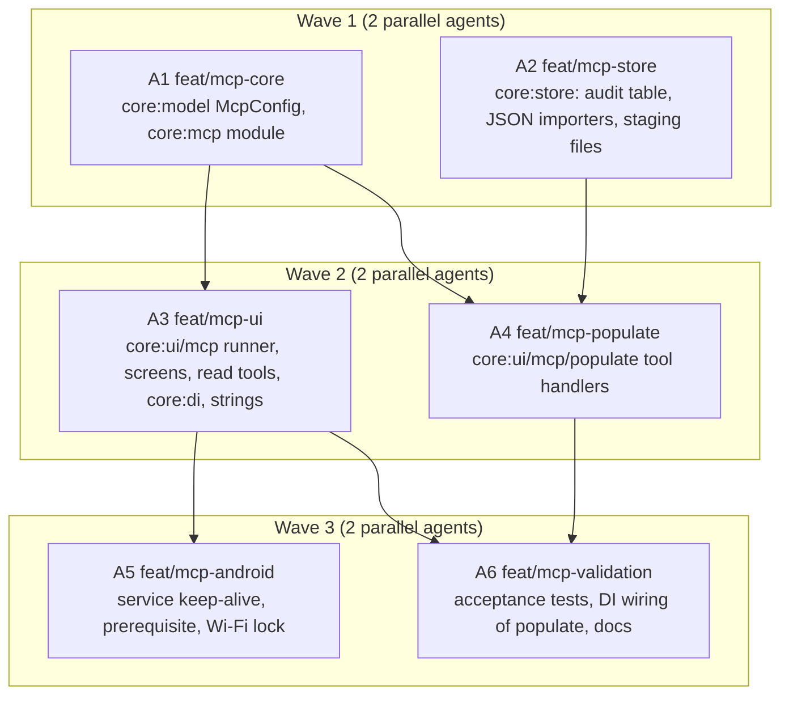

# MCP server implementation plan

This document divides the work of [docs/mcp-proposal.md](mcp-proposal.md) and of
[issue 59](https://github.com/Super-DRO/SuperDRO/issues/59) into three waves and six agent tracks.
Parallel agents in one wave touch different modules or different files, so their branches merge
with no conflicts. Section 3 gives the contracts that two or more tracks share. An agent must use
these names. A change of a shared contract needs the coordinator.

## 1. Work rules for all agents

Each agent must follow [CLAUDE.md](../CLAUDE.md):

1. Work only in your own worktree (`.worktrees/<track>`) on your own branch (`feat/<track>`), made
   from `origin/main`. Never commit on `main`. Never merge, rebase, or push. The coordinator merges.
2. Write all comments, KDoc, documents, and commit messages in ASD-STE100 Simplified Technical
   English. Do not add `Co-Authored-By` trailers or AI markers.
3. Keep all lengths in micrometers (`Double`) and all angles in arc seconds (`Double`) in the
   stored models and in the internal code. The MCP tools convert at the edge (section 3.8).
4. Run only the Gradle tasks of the modules that you change, with the memory-limit flags:
   ```bash
   ./gradlew --max-workers=4 -Dorg.gradle.jvmargs="-Xmx6g -XX:+UseParallelGC" \
     -Pkotlin.compiler.execution.strategy=in-process <tasks>
   ```
5. Put UI strings only in `strings_mcp.xml`, in all six locales (`values`, `values-es`, `values-fr`,
   `values-de`, `values-pt-rBR`, `values-nl`). Write a plain apostrophe, never `\'`.
6. Before you report, run the JVM tests of your modules and `:validation:testMcp`. Run
   `scripts/validate.sh` when your track says so.
7. Read the proposal sections that your track names before you write code.

## 2. Waves



The coordinator merges each wave before the next wave starts. Each track lists its files. A file
that is not in your list belongs to another track: do not change it. Ask the coordinator when you
need a change there.

## 3. Shared contracts

### 3.1 `core:model` (track A1)

```kotlin
package org.superdro.core.model

@Serializable enum class McpScope { Read, Populate, Control }
@Serializable enum class McpActivation { OnDemand, AlwaysOn }
@Serializable enum class McpConfirmation { Risky, All, Off }

@Serializable
data class McpConfig(
    val enabled: Boolean = false,
    val activation: McpActivation = McpActivation.OnDemand,
    /** Only WiFi, Localhost, and UsbEthernet are valid (McpRules.ALLOWED_INTERFACES). */
    val bindInterface: BindInterface = BindInterface.WiFi,
    val port: Int = DEFAULT_PORT,                       // 5810
    val plainHttpConfirmed: Boolean = false,
    /** Read is always in the set while enabled. */
    val scopes: Set<McpScope> = setOf(McpScope.Read),
    val populateConfirmed: Boolean = false,
    val controlConfirmed: Boolean = false,
    val confirmation: McpConfirmation = McpConfirmation.Risky,
    /** The control tools that are on. A tool that is not in the set is off. */
    val controlTools: Set<String> = emptySet(),
    val liveUpdates: Boolean = false,
    val liveRateHz: Int = 2,
)
```

`AppSettings` gets `val mcp: McpConfig = McpConfig()`.

### 3.2 `core:mcp` tool and resource contract (track A1; used by A3, A4)

Package `org.superdro.core.mcp`. The module depends only on `core:connection`, `core:model`,
`core:util`, `core:data-output`, kotlinx-coroutines, and kotlinx-serialization. No Compose, no
store, no Ktor server.

```kotlin
data class ToolAnnotations(
    val readOnlyHint: Boolean = false,
    val destructiveHint: Boolean = true,
    val idempotentHint: Boolean = false,
    val openWorldHint: Boolean = false,
)

data class McpToolSpec(
    val name: String,                 // snake_case, 1 to 64 characters
    val title: String,
    val description: String,
    val inputSchema: JsonObject,      // JSON Schema, draft 2020-12 subset
    val scope: McpScope,
    val annotations: ToolAnnotations,
    /** Sets _meta["anthropic/requiresUserInteraction"] = true on the tool. */
    val requiresUserInteraction: Boolean = false,
)

/** The caller of one tool call. */
data class McpClient(val host: String, val era: McpEra)
enum class McpEra { Modern, Legacy }

class ToolCall(
    val name: String,
    val arguments: JsonObject,
    val client: McpClient,
    /** Sends notifications/progress when the client gave a progressToken. */
    val progress: suspend (progress: Double, total: Double?, message: String?) -> Unit,
)

sealed interface ToolResult {
    /** A success. [text] is the content block; [structured] is structuredContent or null. */
    data class Ok(val text: String, val structured: JsonElement? = null) : ToolResult
    /** isError: true with [message]. */
    data class Error(val message: String) : ToolResult
}

fun interface McpToolHandler { suspend fun call(call: ToolCall): ToolResult }

data class McpTool(val spec: McpToolSpec, val handler: McpToolHandler)

data class McpResourceSpec(
    val uri: String,                  // superdro://... ; a template has {name} parts
    val name: String,
    val title: String,
    val description: String,
    val mimeType: String = "application/json",
    val isTemplate: Boolean = false,
)

data class ResourceContent(val uri: String, val mimeType: String, val text: String)

fun interface McpResourceReader { suspend fun read(uri: String): ResourceContent? }

/** One group of tools and resources. The server merges the sets. A duplicate name is an error at start. */
interface McpToolSet {
    val tools: List<McpTool>
    val resources: List<Pair<McpResourceSpec, McpResourceReader>>
}
```

The server offers a tool only when its scope is in `McpConfig.scopes`. A call of a tool that is
not offered gives the JSON-RPC error `-32602` with "The tool is not available".

### 3.3 `core:mcp` write gate (track A1; implemented by A3, used by A4)

```kotlin
/** A write that needs the operator. */
data class WriteRequest(
    val toolTitle: String,
    /** One line, for example "Zero X on Mill (Workspace 1)". */
    val summary: String,
    /** The details, one line each: the counts, the names, the client host. */
    val details: List<String>,
    val client: McpClient,
)

enum class GateDecision { Allowed, Refused, Timeout }

interface WriteGate {
    /** Waits for the operator up to [McpLimits.CONFIRM_TIMEOUT_MS]. */
    suspend fun confirm(request: WriteRequest): GateDecision
}

/** The gate of a server with the confirmation Off, and the gate of the tests. */
object OpenWriteGate : WriteGate { override suspend fun confirm(request: WriteRequest) = GateDecision.Allowed }
```

A handler calls `gate.confirm` when `McpRules.needsConfirmation(config.confirmation, risky)` is
true. The handler decides `risky` with the table of section 4 of the issue comment. A `Refused`
result gives `ToolResult.Error("The operator refused the call")`. A `Timeout` gives
`ToolResult.Error("No answer on the tablet")`.

### 3.4 `core:mcp` file store (track A1; implemented by A3 on `StagingFiles` of A2)

```kotlin
data class UploadReceipt(val fileId: String, val bytes: Long, val sha256Hex: String)
data class StoredFile(val fileId: String, val contentType: String, val bytes: ByteArray)

interface McpFileStore {
    suspend fun putUpload(contentType: String, bytes: ByteArray): UploadReceipt
    /** Gives the upload, or null when it is not there or expired. */
    suspend fun upload(fileId: String): StoredFile?
    suspend fun putDownload(fileName: String, contentType: String, bytes: ByteArray): String
    suspend fun download(fileId: String): StoredFile?
}

object McpLimits {
    const val MCP_BODY_BYTES: Int = 2 * 1024 * 1024
    const val UPLOAD_BYTES: Int = 8 * 1024 * 1024
    const val FILE_TTL_MS: Long = 60 * 60 * 1000L
    const val CONFIRM_TIMEOUT_MS: Long = 60_000L
    const val REQUESTS_PER_SECOND: Int = 20
    const val SSE_KEEP_ALIVE_MS: Long = 15_000L
}
```

### 3.5 `core:mcp` server (track A1; used by A3)

```kotlin
class McpServer(
    scope: CoroutineScope,
    sockets: ListenSocketFactory,
    bindHosts: suspend () -> List<String>,
    port: Int,
    /** The bearer token bytes. Null while the token is not there: each request gets 401. */
    token: () -> ByteArray?,
    toolSets: () -> List<McpToolSet>,
    scopes: () -> Set<McpScope>,
    files: McpFileStore,
    clock: Clock,
    onCall: (McpCallRecord) -> Unit,
    onError: (McpError) -> Unit,
) {
    val state: StateFlow<McpServerState>     // Stopped, Starting, Ready, Active (a client in a call), Failed(error, retryAtMs)
    val listening: StateFlow<List<String>>   // host:port
    val clients: StateFlow<List<String>>     // hosts with a request in the last 60 s
    fun start(); fun stop(); fun restart()
}

data class McpCallRecord(
    val atMs: Long, val client: McpClient, val tool: String?, val method: String,
    val argumentsJson: String?, val result: McpCallOutcome, val durationMs: Long,
)
enum class McpCallOutcome { Ok, Error, Refused, Timeout, Unauthorized }
```

Routes: `POST /mcp`, `GET /mcp` → 405, `POST /upload`, `GET /download/{fileId}`, `GET /` → a
plain text line `SuperDRO <version> MCP server`. Each other path → 404. The era selection, the
header checks, the `Origin` and `Host` checks, the bearer check, and the rate limit follow the
proposal sections 4.4 and 4.5.

### 3.6 `core:mcp` rules and secrets (track A1; used by A3)

```kotlin
object McpRules {
    val ALLOWED_INTERFACES: Set<BindInterface>   // WiFi, Localhost, UsbEthernet
    fun runs(config: McpConfig, startedOnDemand: Boolean, localNetworkGranted: Boolean, localNetworkNeeded: Boolean): Boolean
    fun needsPlainHttpWarning(config: McpConfig): Boolean      // interface != Localhost && !plainHttpConfirmed
    fun localNetworkRequest(config: McpConfig): ConnectionRequest?   // null for Localhost
    fun needsConfirmation(confirmation: McpConfirmation, risky: Boolean): Boolean
    fun url(host: String, port: Int): String                   // http://host:port/mcp, [host] for IPv6
    fun claudeCodeCommand(url: String, token: String): String
}

class McpSecrets(store: SecretStore) {
    val tokenName: String = "mcp.token"
    fun token(): String?            // 43 base64url characters
    fun tokenOrCreate(): String
    fun replaceToken(): String
    fun delete()
}
```

### 3.7 `core:store` additions (track A2; used by A3, A4)

```kotlin
// Audit log
data class McpCallRow(val id: Long, val atMs: Long, val client: String, val era: String, val tool: String?,
    val method: String, val argumentsJson: String?, val result: String, val durationMs: Long, val previousJson: String?)
class McpCallRepository(writer: StoreWriter) {
    suspend fun insert(row: McpCallRow): Long
    fun last(count: Int): Flow<List<McpCallRow>>
    suspend fun prune(olderThanMs: Long)
}

// Staging files under mcp/uploads/<id> and mcp/downloads/<id>, with a JSON sidecar for the content
// type, the name, and the time.
class StagingFiles(io: StoreIOProvider, folder: String, clock: WallClock) {
    suspend fun put(id: String, contentType: String, fileName: String?, bytes: ByteArray)
    suspend fun get(id: String): StagedFile?
    suspend fun delete(id: String)
    suspend fun expire(ttlMs: Long): Int
}
data class StagedFile(val id: String, val contentType: String, val fileName: String?, val atMs: Long, val bytes: ByteArray)

// JSON row sources. The plan and the preview types stay the CSV types.
class SubDatumJsonImporter(now: () -> Instant) {
    fun read(rows: List<JsonObject>, metric: Boolean, context: SubDatumImportContext): SubDatumImportPreview
}
class ToolJsonImporter(now: () -> Instant) {
    fun read(rows: List<JsonObject>, context: ToolImportContext): ToolImportPreview
}
```

The JSON row keys are the CSV column names (`id`, `name`, `note`, `x`, `y`, `z`, `a`, `tags`;
`id`, `name`, `description`, `metric`, `diameter`, `tooth_count`, `z_offset`, `internal`,
`x_offset`). A number is a JSON number or a text in the CSV form. The refactor extracts the
row-to-record and the plan code of `SubDatumCsvImporter` and `ToolCsvImporter` into internal
functions that both sources call. The CSV tests must pass with no change.

As built by A2 (the differences from the text above):

- `StagingFiles(io, folder, clock: kotlin.time.Clock = Clock.System, dispatcher = storeIoDispatcher)`.
  `WallClock` is a type of `core:data-output`, not of `core:util`, so the store uses `kotlin.time.Clock`.
- An ID has only `A-Z`, `a-z`, `0-9`, `-`, and `_`. Another ID throws `IllegalArgumentException`.
  The upload ID generator of A3 gives such IDs (hex or a UUID).
- `StagingFiles` keeps `<folder>/.index.json` next to the sidecars, so `expire` needs no folder
  list. Nobody else writes in a staging folder.
- `McpCallRepository.prune(olderThanMs)` deletes the rows with `at_ms < olderThanMs` (an absolute
  cutoff). The caller gives `now - retention`. `insert` ignores `row.id` and gives the database ID.
  There is also `count()`.
- The sub-datum JSON source offers `UpdateMatching` (the default; match by `id`, then by name),
  `AddAsNew`, `AddNewOnly`, `MergeMatching`, and `ReplaceAll`. The CSV source is unchanged.
- JSON values: a string is text; a number keeps its literal text (the decimals give the match
  tolerance); `true` and `false` are `yes` and `no`; an array joins its items with a space (`tags`);
  `null` or a missing key is blank. `a` is in degrees at the importer boundary and is stored as
  arc seconds. `x`, `y`, `z` are in the unit of the `metric` argument. The JSON importers emit no
  units warning: the caller gives `metric`.

### 3.8 Units at the edge (track A4)

```kotlin
object McpUnits {
    /** "mm", "inch", or "um". */
    fun lengthToUm(value: Double, units: String): Double
    fun lengthFromUm(um: Double, units: String): Double
    fun angleToArcSec(degrees: Double): Double
    fun angleFromArcSec(arcSec: Double): Double
    fun defaultUnits(profile: MachineProfile): String      // "mm" when metricDefault else "inch"
}
```

### 3.9 Resource URIs (tracks A3, A4)

| URI | Reader |
|---|---|
| `superdro://machines` | A3 |
| `superdro://machines/{machine}/profile-settings` | A3 |
| `superdro://machines/{machine}/workspaces` | A3 |
| `superdro://machines/{machine}/workspaces/{workspace}` | A3 |
| `superdro://machines/{machine}/tools` | A3 |

`{machine}` is a profile ID or a profile name. `{workspace}` is a workspace ID or a name.

## 4. Wave 1

### A1: `feat/mcp-core`

Read the proposal sections 2, 4, 5, and 6, and the issue comment section 2.

Files:
- `core/model/src/commonMain/kotlin/org/superdro/core/model/McpConfig.kt` (new), `AppSettings.kt`
  (one field).
- `core/mcp/` (new module): `build.gradle.kts` with `superDroTargets("org.superdro.core.mcp")`,
  `src/commonMain/kotlin/org/superdro/core/mcp/`:
  `JsonRpc.kt`, `McpProtocol.kt`, `McpTools.kt` (section 3.2), `WriteGate.kt`, `McpFileStore.kt`,
  `McpLimits.kt`, `Http.kt` (request parser, response writer, SSE writer), `HttpListener.kt`,
  `McpServer.kt`, `McpRules.kt`, `McpSecrets.kt`, `JsonSchema.kt` (a small builder:
  `objectSchema { string("name", required = true) ... }`).
- `core/mcp/src/commonTest/...`: the tests with `FakeSockets` (copy the pattern of
  `core/data-output/src/commonTest/.../FakeSockets.kt`; do not change the data output tests).
- `settings.gradle.kts`: `include(":core:mcp")`.
- `validation/build.gradle.kts`: `mcpTestDeps`, `mcpRuntime`, `testMcp` for
  `org/superdro/validation/mcp/**`. `validation/src/test/kotlin/org/superdro/validation/ArchitectureTest.kt`:
  add `mcp` to `allowedDomains`; add the rule "core:mcp depends only on core:connection,
  core:model, core:util, core:data-output" and "app:adapter-probe does not depend on core:mcp".
  Add one test `validation/src/test/kotlin/org/superdro/validation/mcp/McpRulesValidationTest.kt`
  with the run rule and the warning rule, so the domain task has a class.
- `CLAUDE.md` and `README.md`: add `:validation:testMcp` to the task lists, and the module row.

Protocol work:
- Dual-era selection (proposal 4.4). Modern: no session, header checks, `-32020` on a header
  mismatch, `-32022` with the supported list on an unknown version, 404 and `-32601` on an unknown
  method. Legacy: `initialize` answers with the client version when the server knows it
  (`2025-11-25`, `2025-06-18`, `2025-03-26`, `2024-11-05`), else `2025-11-25`; `notifications/initialized`
  gives 202; `ping` gives `{}`.
- Methods: `initialize`, `ping`, `tools/list`, `tools/call`, `resources/list`, `resources/read`,
  `resources/templates/list`, `server/discover` (modern). `tools/list` in the modern era has
  `resultType`, `ttlMs` (60000), `cacheScope` (`"server"`); the tools come in a fixed order.
- `tools/call` runs the handler, sends progress notifications on an SSE response when the client
  gave `_meta.progressToken`, else answers with JSON. A handler exception gives `isError: true` with
  the message, never a 500.
- HTTP: POST with `Content-Length` only (411 for chunked), 413 above the limit, 415 for a body
  that is not JSON, 404 for other paths, 401 with `WWW-Authenticate: Bearer realm="SuperDRO"`,
  403 for a bad `Origin` or `Host`, 429 above the rate, and the ten-failures lock of proposal 4.5.
  SSE: `event: message` frames and a comment keep-alive each 15 s.
- `McpServer` follows `TcpOutputServer`: one run, stop closes all at once, retry after 5 s on a
  bind failure, `PortRegistry` claim with the owner `"mcp"`.

Tests to write: JSON-RPC parse and error codes; each method in both eras; the header rules; the
auth, `Origin`, `Host`, and rate rules; `/upload` and `/download` with a fake file store; the
server start, stop, and bind failure with `FakeSockets`; `McpRules`; `McpSecrets` with
`InMemorySecretStore`. Run `:core:mcp:jvmTest`, `:core:model:jvmTest`, `:validation:testMcp`,
`:validation:testProject`, and `scripts/validate.sh`.

### A2: `feat/mcp-store`

Read the issue comment sections 2 and 3, and section 3.7 of this document.

Files:
- `core/store/src/commonMain/sqldelight/org/superdro/core/store/db/McpCall.sq` (new) and the
  migration `.sqm` of the next schema version. Run `:core:store:verifySqlDelightMigration`.
- `core/store/src/commonMain/kotlin/org/superdro/core/store/repository/McpCallRepository.kt` (new).
- `core/store/src/commonMain/kotlin/org/superdro/core/store/files/StagingFiles.kt` (new).
- `core/store/src/commonMain/kotlin/org/superdro/core/store/files/subdatum/SubDatumCsv.kt` and
  `SubDatumJson.kt` (new); `.../files/tool/ToolCsv.kt` and `ToolJson.kt` (new).
- Tests in `core/store/src/jvmTest/...` for the repository, the staging files (with the JVM
  `StoreIOProvider`), and the JSON importers (the same cases as the CSV tests, in JSON form).

Run `:core:store:jvmTest`, `:core:store:verifySqlDelightMigration`, `:validation:testStore`, and
`scripts/validate.sh`.

## 5. Wave 2

### A3: `feat/mcp-ui`

Read the proposal sections 4.5, 4.6, 6, 7.3, 7.5, and the issue comment sections 1 and 4. Read
`core/ui/src/commonMain/kotlin/org/superdro/core/ui/dataoutput/` as the pattern.

Files:
- `core/ui/src/commonMain/kotlin/org/superdro/core/ui/mcp/`: `McpRunner.kt` (owns one
  `McpServer`; reads `AppSettingsStore`; the token from `McpSecrets`; `bindHosts` from
  `NetworkInterfaces` with `selectInterfaces`; the on-demand start; the `onCall` records to
  `McpCallRepository`), `McpGate.kt` (a `WriteGate` with a `StateFlow<WriteRequest?>` of the pending
  request and `allow()` and `refuse()`; one request at a time, the next waits), `McpFiles.kt`
  (`McpFileStore` on `StagingFiles`, with the expiry each 10 minutes), `ReadToolSet.kt` (the read
  tools `list_machines`, `list_workspaces`, `get_workspace`, `list_tools`, `get_profile_settings`,
  `get_app_info`, and the resources of section 3.9), `McpSettingsPresenter.kt`, `McpSettingsScreen.kt`
  (sections Status, Access, Network, Token, Diagnostics; the warnings of proposal 4.6 and the
  issue comment section 1; the QR code of the URL; the Claude Code command with a copy button;
  the audit log list), `McpChipPresenter.kt`, `McpChip.kt`, `McpConfirmationDialog.kt`,
  `McpUiState.kt`, `McpTexts.kt`.
- The navigation entry in `core/ui/.../settings/SettingsEntries.kt` and the chip in the status
  strip next to the data output chip (`StatusStrip.kt`), the dialog in `AppFrame.kt`.
- `core/ui/build.gradle.kts`: `registerUiDomainTest("jvmTestMcp", listOf("org/superdro/core/ui/mcp/**/*Test*"), ...)`
  and the dependency on `projects.core.mcp`.
- `core/di/src/commonMain/kotlin/org/superdro/core/di/McpDiModule.kt` (new): `McpSecrets`,
  `McpFiles`, `McpGate`, `McpRunner` (background start as `dataOutputDiModule`), the presenters;
  `toolSets` is a `List<McpToolSet>` binding with the read set only. A6 adds the populate set.
  Add the module to `coreDiModule`.
- `core/resources/src/commonMain/composeResources/values*/strings_mcp.xml` (six files).
- `CLAUDE.md`: add `:core:ui:jvmTestMcp` to the task list.

Tests: the presenter rules, the gate (allow, refuse, timeout with virtual time), the read tools
against an in-memory database (see `core/ui/src/jvmTest` for the pattern of the data output tests),
`:core:di:jvmTest` graph test `McpGraphTest`. Run `:core:ui:jvmTestMcp`, `:core:di:jvmTest`,
`:core:resources:localizationCheck`, `:validation:testUi`, and `scripts/validate.sh`.

### A4: `feat/mcp-populate`

Read the issue comment sections 3 and 4, the proposal section 6, and section 3 of this document.

Files, all new, under `core/ui/src/commonMain/kotlin/org/superdro/core/ui/mcp/populate/`:
- `PopulateToolSet.kt`: `fun populateToolSet(deps: PopulateDeps): McpToolSet` with
  `class PopulateDeps(machines: MachineRepository, tools: ToolRepository, drawings: DrawingRepository,
  files: McpFileStore, gate: WriteGate, config: () -> McpConfig, onlineMachines: () -> Set<String>,
  appVersion: String, clock: WallClock)`.
- `McpUnits.kt` (section 3.8), `MachineLookup.kt` (ID or name to profile), `PopulateSchemas.kt`.
- `WorkspaceTools.kt`: `create_workspace`, `update_workspace`, `delete_workspace`,
  `put_sub_datums`, `delete_sub_datums`, `put_guides`.
- `DrawingTools.kt`: `set_drawing`, `clear_drawing` with `DrawingImporter.import` and the DXF
  limits of the profile, and the wireframe JSON inline form.
- `ImageTools.kt`: `set_reference_image`, `clear_reference_image` with `ReferenceImageMath.fit`
  for the reference pairs; the image file goes to `images/<uuid>.jpg` through
  `MachineRepository.setReferenceImage` as the camera code does.
- `ToolLibraryTools.kt`: `put_tools`, `delete_tools`, `set_tool_outline`, `clear_tool_outline`,
  `export_tools` (`ToolCsv` export to the download store).
- `ProfileTools.kt`: `put_profile_settings` (refused while online), `create_profile`,
  `export_profile_bundle`, `import_profile_bundle`.
- Tests in `core/ui/src/jvmTest/kotlin/org/superdro/core/ui/mcp/populate/` against an in-memory
  database, with `OpenWriteGate` and a recording gate.

Rules:
- Each write tool has `preview: Boolean` (default false). The preview gives the plan as text and
  as structured JSON (`toImport`, `skipped`, `warnings`).
- Each tool answers in the `units` of the call. The default is `McpUnits.defaultUnits(profile)`.
- `risky` follows the table of the issue comment section 4. The handler calls the gate before the
  write and never after it.
- The result text of a write names the counts, for example "3 points added, 1 point updated".
- Annotations: `readOnlyHint = true` for the read tools; the write tools have
  `destructiveHint = true`, `idempotentHint` as in the issue tables, and
  `requiresUserInteraction = true` for the deletes, `clear_*`, `REPLACE_ALL`, and the profile
  tools.

Run `:core:ui:jvmTestMcp` (after A3 merges, the task exists; before that, run `:core:ui:jvmTest`
with `--tests "org.superdro.core.ui.mcp.populate.*"`), `:validation:testMcp`, and
`scripts/validate.sh`.

## 6. Wave 3

### A5: `feat/mcp-android`

Read the proposal sections 3.2, 5, and 9.3.

Files:
- `core/connection/.../ConnectionKeepAlive.kt`: `KeepAliveSummary.mcpServer: Boolean = false`;
  `KeepAliveController` takes the server state; the summary is not null while the server runs.
- `platform/android/service/`: `ForegroundPrerequisite` accepts the declared
  `CHANGE_WIFI_MULTICAST_STATE` for the MCP server; `NotificationContent` gets the line
  "MCP server on <host:port>"; `WakeLockController` gets the `WifiLock` in low-latency mode while
  the server runs and the screen is on.
- `app/android/src/main/AndroidManifest.xml`: `CHANGE_WIFI_MULTICAST_STATE`.
- The local network permission request before the start (through the request bus, as
  `DataOutputChipPresenter` does) stays in A3; A5 checks it on the emulator.

Run `:platform:android:service:testDebugUnitTest`, `:core:connection:jvmTest`, and
`scripts/validate.sh --android`.

### A6: `feat/mcp-validation`

Files:
- `core/di/.../McpDiModule.kt`: add `populateToolSet(...)` to the tool sets.
- `validation/src/test/kotlin/org/superdro/validation/mcp/`: the acceptance tests of the
  requirements: off by default and no socket; the run rule; the plain HTTP warning; the scopes; the
  era selection against a real `McpServer` on a loopback socket (both eras with raw HTTP);
  `/upload` then `set_drawing` with a small DXF; `put_tools` preview and write; the confirmation
  rules with a recording gate; the audit log rows.
- `README.md` module table and documents table; `docs/mcp-proposal.md` section 7 gets the final
  tool list (a pointer to the issue and to this plan is enough).
- A manual check with the desktop app: start `app:desktop`, turn the server on with the
  interface Localhost, and run `curl` in the modern form and in the legacy form. Write the result
  in `docs/mcp-proposal.md` section 12.

Run `:validation:testMcp`, `:validation:testProject`, `:core:di:jvmTest`, and `scripts/validate.sh`.

## 7. Decisions on the open questions of the issue

1. `REPLACE_ALL` stays available. It always needs the confirmation on the tablet.
2. `put_profile_settings` is refused while the machine is online. The error names the reason.
3. The outline and the drawing accept a DXF file and the wireframe JSON. `DrawingImporter` detects
   the type.
4. The reference image accepts the matrix and the reference pairs.
