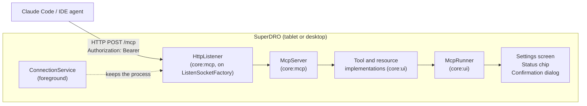

# MCP server proposal

This document is a design proposal. It gives the research on the Model Context Protocol (MCP), the
limits of Android networking, and a design for an MCP server in SuperDRO. An AI agent on a different
device can then read the readout and, after a second opt-in, control some functions of the app.

The request of the user is [issue 59](https://github.com/Super-DRO/SuperDRO/issues/59). Section 7
gives the final tool list, as built. Section 12 gives the implementation notes and the manual check.

## 1. Goals and rules

1. **Off by default.** The app has no MCP server and no open port until the user turns the server on
   in the settings. This is the same rule as the data output (`DataOutputConfig.enabled = false`).
2. **Two opt-ins.** The first switch gives read access. A second switch, with its own warning,
   gives control. A control tool call needs a tap on the tablet by default (section 6.4).
3. **One protocol, two eras.** The server speaks Streamable HTTP in the stateless form of the
   2026-07-28 revision, and also the legacy `initialize` form of 2025-11-25 (section 3.2).
4. **Reuse.** The server uses the sockets, the port registry, the bind interfaces, the secret store,
   the foreground service, and the permission flow of the data output (section 5).
5. **No new Google library.** The server uses kotlinx-serialization and the socket code of the app.
   Section 4.3 gives the decision on the official Kotlin SDK.
6. **Local network only.** The server serves the devices on the same network as the tablet, for
   example a workstation in another room. Access from outside the network is the responsibility of
   the user and is out of scope (section 8).

## 2. Research: the MCP protocol

The facts come from the specification pages at `modelcontextprotocol.io`, the Kotlin SDK repository,
and the Claude documentation, read on 2026-10-23.

### 2.1 Revisions

| Revision | State | Notes |
|---|---|---|
| 2026-07-28 | Latest ("modern") | Stateless. No `initialize`, no `Mcp-Session-Id`, no GET stream, no `resources/subscribe`. Adds `server/discover`, `subscriptions/listen`, and the `Mcp-Method` and `Mcp-Name` headers. Deprecates Roots, Sampling, and Logging. |
| 2025-11-25 | "Legacy", most shipped clients and SDKs | `initialize` handshake, optional session ID, POST and GET on one endpoint, SSE resumability. |
| 2025-03-26, 2025-06-18 | Older legacy | The server can treat a request with no `MCP-Protocol-Version` header as 2025-03-26. |
| 2024-11-05 HTTP+SSE | Deprecated | Do not implement. |

Claude Code speaks 2026-07-28 in its v2 runtime (default since v2.1.232). The official Kotlin SDK
0.15.0 implements 2025-11-25 and has open work for 2026-07-28. Cursor and VS Code follow
2025-11-25 at the time of the research. Thus the server must serve both eras. The specification
calls this a "dual-era" server: it selects the legacy semantics when it receives `initialize`, and
the stateless semantics when a request carries the modern `_meta` protocol version.

### 2.2 Streamable HTTP, the parts the server needs

- One endpoint path, for example `/mcp`. Each client message is one HTTP POST with one JSON-RPC
  request or notification. The response is `application/json`, or `text/event-stream` for a
  request-scoped SSE stream. A notification gets `202 Accepted`.
- Modern era: no GET, no DELETE (`405`), no session. Required headers on each POST:
  `MCP-Protocol-Version`, `Mcp-Method`, and `Mcp-Name` for `tools/call`, `resources/read`, and
  `prompts/get`. A mismatch between the header and `_meta` gives `400` with the error `-32020`.
- Legacy era: GET opens an SSE stream (the server can answer `405`). The server can mint an
  `Mcp-Session-Id` at `initialize`; a stateless legacy server does not.
- `Origin` header: the server MUST check it and answer `403` to a bad value. The reason is the DNS
  rebinding attack from a web page in a browser on the same network.
- The specification says a local server SHOULD bind to `127.0.0.1`. A LAN server cannot. Thus
  authentication and the `Origin` and `Host` checks carry the protection.
- Long-lived notifications (modern): the client POSTs `subscriptions/listen`; the response is an open
  SSE stream. The server first sends `notifications/subscriptions/acknowledged`. A closed stream is
  the cancel signal.
- Elicitation (modern): the server returns `resultType: "input_required"`; the client asks the user
  and repeats the call with the answers. Claude Code supports the form mode and the URL mode.

### 2.3 Authorization

- Authorization is optional in the specification. The OAuth 2.1 path (RFC 9728 protected resource
  metadata, RFC 8707 resource indicators) is for public servers. Dynamic client registration is
  deprecated in 2026-07-28.
- A static bearer token is not in the specification text. The security document names it as a
  valid restriction for a local HTTP server: "Require an authorization token".
- Claude Code accepts a static header: `claude mcp add --transport http <name> <url> --header
  "Authorization: Bearer <token>"`. Cursor and VS Code accept a `headers` object in their
  configuration. Claude.ai connectors accept static headers only in a beta for some organizations.
- Claude Code (v2 runtime) sends OAuth credentials only to an HTTPS or loopback token endpoint. A
  plain `http://` token endpoint on a LAN device fails. This rule concerns OAuth only. The
  documentation does not state whether a plain `http://<LAN IP>/mcp` URL with a static header works.
  The spike in section 9 tests this first.

### 2.4 Tool annotations and client behavior

- Annotations: `readOnlyHint` (default false), `destructiveHint` (default true), `idempotentHint`
  (default false), `openWorldHint` (default true). Clients treat them as untrusted unless the server
  is trusted.
- Claude.ai connectors run a read-only tool with no per-call confirmation and always prompt for a
  destructive tool. Claude Code uses `readOnlyHint` and `idempotentHint` to decide a retry after a
  dropped connection, and runs read-only tools in parallel. Claude Code prompts for a tool when
  the server sets `_meta["anthropic/requiresUserInteraction"]: true` on the tool.
- Claude connectors do not support sampling or resource subscriptions. The design does not use
  sampling. It uses `subscriptions/listen` only as an option (section 7.4).
- Limits: Claude Code cuts a tool result at 25,000 tokens. Claude.ai cuts at about 150,000
  characters and 240 s for each call.

### 2.5 Reach of the clients

| Client | Where it runs | Can reach a LAN address |
|---|---|---|
| Claude Code (CLI, IDE) | The computer of the user | Yes |
| Cursor, VS Code Copilot | The computer of the user | Yes |
| Claude.ai, Claude Desktop connectors, Cowork, mobile | The Anthropic cloud (`160.79.104.0/21`) | No. Out of scope (section 8). |
| Claude Desktop `claude_desktop_config.json` | The computer of the user | stdio servers only. An `mcp-remote` bridge gives HTTP. |

Thus the server serves Claude Code and the IDE clients on the network of the tablet.

## 3. Research: Android networking

The facts come from `developer.android.com`, `source.android.com`, and the AOSP sources, read on
2026-10-23. Items with "not verified" need a test on a device.

### 3.1 Server sockets and permissions

- Android 12 to 16: `INTERNET` is enough for a listening TCP socket on each interface.
- Android 16: the local network protection is opt-in through an app-compat flag. It does not change
  the behavior of a normal app.
- Android 17 (API 37): the runtime permission `ACCESS_LOCAL_NETWORK` is mandatory for an app that
  targets API 37. It gates outbound and **inbound** TCP on the local network. An app that targets
  API 36 or lower gets an implicit grant. SuperDRO already declares the permission, asks for it
  before a TCP link or a data output start (`OutputRunRule.localNetworkRequest`), and has the rule
  in `NetworkRules`.
- "Local network" means a broadcast-capable interface: Wi-Fi, Ethernet, USB Ethernet. The MCP
  server binds only to these interfaces and to localhost. Thus each LAN start on API 37 needs the
  permission.
- The outbound cleartext policy (`usesCleartextTraffic`) does not apply to a server socket.

### 3.2 Background limits

- Doze starts only when the device is unplugged, stationary, and the screen is off. A tablet on a
  charger does not enter Doze. In Doze, the system suspends the network of a normal process.
- A process with a foreground service keeps its network in Doze and in Battery Saver
  (`NetworkPolicyManager.FOREGROUND_THRESHOLD_STATE`). SuperDRO has the foreground service
  `ConnectionService` with the type `connectedDevice`. The data output already runs in this service
  with no change to the service.
- The type `connectedDevice` has no time limit. The type `dataSync` has a limit of 6 hours in 24
  hours on Android 15 and higher. Do not use `dataSync`.
- The `connectedDevice` prerequisite on Android 14 and higher: SuperDRO meets it with
  `BLUETOOTH_CONNECT`, a USB grant, or `CHANGE_NETWORK_STATE` plus a TCP machine
  (`ForegroundPrerequisite`). An MCP server with no online machine does not meet it today. The
  normal permission `CHANGE_WIFI_MULTICAST_STATE` also meets it, and the mDNS option of section 7.5
  needs it. Phase 2 adds it.
- A `WifiLock` in the mode `WIFI_MODE_FULL_LOW_LATENCY` turns off the Wi-Fi power save only while the
  screen is on and the app is in the foreground. With the screen off, inbound latency can go up to
  seconds. The DRO tablet has the screen on in use, so this is acceptable.

### 3.3 Discovery

- `NsdManager` (DNS-SD over mDNS) is reliable on Android 14 and higher (platform Java stack). Android
  12 and 13 use the legacy daemon with known defects (empty TXT records, lost-and-found loops).
- A QR code and a shown URL have no network dependency and work with each client. Phase 1 uses them.
  mDNS is an option for a later phase.
- Whether `NsdManager.registerService()` needs `ACCESS_LOCAL_NETWORK` on API 37 is not documented.

### 3.4 TLS on a LAN

- The MCP clients are Node.js (Claude Code), Python, and IDE processes. They trust the system CA
  store and a custom CA through `NODE_EXTRA_CA_CERTS` or an httpx context. None of them supports
  TLS with a pre-shared key. Thus the PSK mode of the data output (`PskTlsSecurity`) does not
  protect the MCP link directly. It can protect a local bridge in a later phase (section 8.3).
- A self-signed certificate for an IP address breaks when the IP changes, and each client needs a
  trust step. Similar LAN tools (Home Assistant, OctoPrint) serve plain HTTP by default and leave
  TLS to a reverse proxy.
- Decision: phase 1 serves plain HTTP with a bearer token on the LAN, after the same kind of warning
  as the plain text mode of the data output. An app-generated certificate and the PSK bridge
  (section 8.3) are the encryption options for phase 3.

### 3.5 Access from outside the network

The research looked at tunnels (Cloudflare Tunnel, ngrok), at a relay with a device-initiated
WebSocket, and at a VPN on the tablet. None of them is part of this proposal. The user who needs
access from outside the network selects an own solution, and the solution must make the client a
device on the local network of the tablet (section 8).

### 3.6 Libraries

| Library | License | Android | Notes |
|---|---|---|---|
| Official Kotlin SDK `io.modelcontextprotocol:kotlin-sdk-server` 0.15.0 | MIT and Apache 2.0 | No Android target. The JVM artifact works on Android as BouncyCastle and Paho do. | Needs `ktor-server-core`, `ktor-server-sse`, websockets, content negotiation, plus an engine (CIO). Protocol 2025-11-25 only. DNS rebinding plugin on by default blocks a non-localhost `Host`. |
| Ktor server CIO 3.6.0 | Apache 2.0 | Community reports only. Netty and Jetty fail on Android. | No HTTP/2 (not needed). |
| NanoHTTPD | BSD-3 | Yes | Last release 2016. |
| `ktor-network` (already in the app) | Apache 2.0 | Yes, in use by `core:connection-tcp` | Raw sockets. The data output has its own `ListenSocketFactory` on `java.net`. |

## 4. Design: the server

### 4.1 Overview



The app has one server. The server is not per machine profile, because an agent needs a view of all
machines, and because the tablet has one network identity. A tool takes a `machine` argument where it
applies, and the default is the machine of the selected tab.

### 4.2 Layers in `core:mcp`

| Layer | Content | Dependencies |
|---|---|---|
| `JsonRpc` | The JSON-RPC 2.0 messages, the error codes (`-32600` to `-32603`, `-32020` to `-32099`), the `_meta` fields | kotlinx-serialization |
| `McpProtocol` | `initialize`, `ping`, `tools/list`, `tools/call`, `resources/list`, `resources/read`, `resources/templates/list`, `server/discover`, `subscriptions/listen`; the dual-era selection; the capability object | `JsonRpc` |
| `ToolRegistry` | The tool contract: name, title, description, input schema, annotations, the `readOnly` and `control` class, the handler | none |
| `HttpListener` | HTTP/1.1 request parsing for POST with `Content-Length`, the response writer for JSON and SSE, the `Origin` and `Host` checks, the bearer check, the body size cap | `ListenSocketFactory`, `ByteLink` from `core:data-output` |
| `McpServer` | Start and stop, the bind hosts from `NetworkInterfaces`, the `PortRegistry` claim, the state flow, the client list | all above, `core:connection` |
| `McpRules` | The pure rules: run rule, warning rule, permission request rule, URL and share text, the rate limits | `core:model` |

The HTTP layer is small on purpose. It accepts `POST /mcp` with `Content-Type: application/json`
and a `Content-Length` body. It rejects a chunked request body (`411`), a body above 1 MiB (`413`),
and each other path (`404`). It answers `GET /mcp` with `405` in both eras, and `GET /` with a short
plain text page that names the app and the version (a connectivity check in a browser, no secrets).
The SSE writer sends `event: message` frames and a comment keep-alive each 15 s.

The JSON-RPC and MCP layers have no socket. A `commonTest` drives them with text, as
`TcpOutputServerTest` drives the data output with `FakeSockets`.

### 4.3 Decision: own implementation, not the Kotlin SDK

The recommendation is an own implementation of the layers above. The reasons:

1. The needed protocol surface is small: about ten methods, no sampling, no roots, no prompts in
   phase 1. The stateless era removes the session logic.
2. The SDK implements 2025-11-25 and has no Android target. Its server module pulls Ktor server,
   SSE, and websockets, and needs a Ktor engine whose Android support is community evidence only.
3. The app already has a tested socket layer, a port registry, a bind interface model, and a secret
   store. The SDK cannot use them.
4. The tests of the app use `kotlin-test` with fakes in `commonTest`. An own implementation gets
   the same treatment.

The cost is the HTTP/1.1 parser and the SSE writer, an estimated 300 to 500 lines with tests. The
spike (section 9, step 1) measures this. If the spike shows more than 1,000 lines for the HTTP
layer, the fallback is the Kotlin SDK with Ktor CIO in a `jvmAndAndroidMain` source set.

### 4.4 Era selection

| Request | Era | Server behavior |
|---|---|---|
| `initialize` | Legacy | Answers with `protocolVersion` = the client version if the server knows it, else `2025-11-25`. Mints no session ID. Answers `notifications/initialized` with `202`. |
| A request with `_meta["io.modelcontextprotocol/protocolVersion"]` = `2026-07-28` | Modern | Checks the header match. Answers stateless. |
| A request with the header `MCP-Protocol-Version` and no `initialize` before it | Legacy, stateless | Serves the request. A legacy client that skipped `initialize` is tolerated, because the server keeps no session. |
| A request with no version header | Legacy 2025-03-26 | Serves the request. |

The server keeps no state for a client. Thus a process restart, a network change, or a new IP
address needs no recovery on the client side.

### 4.5 Authentication

- One bearer token for the app: 32 random bytes from `secureRandomBytes`, shown as 43 base64url
  characters. The name in the `SecretStore` is `mcp.token`. The token is not in `AppSettings` and
  not in a backup (the Android Keystore key of `platform:android:store` stays on the device).
- The client sends `Authorization: Bearer <token>` on each request. A missing or wrong token gives
  `401` with `WWW-Authenticate: Bearer realm="SuperDRO"`. The comparison is constant-time.
- The settings screen shows the token one time after "New token", as a QR code and as text, with
  the same `KeyClip` copy flow as the PSK of the data output. "New token" stops each client.
- The `Origin` header: a request with an `Origin` that is not `null` and not in the allow list
  (the shown URL of the server, `http://localhost:<port>`, `http://127.0.0.1:<port>`) gets `403`.
  A request with no `Origin` passes, because Claude Code and the IDE clients send none.
- The `Host` header: a request whose `Host` is not an address of the bound interfaces, `localhost`,
  or `127.0.0.1` gets `403`. This stops the DNS rebinding attack that passes the `Origin` check.
- Rate limit: 20 requests per second for each client address, then `429`. Ten failed token checks
  from one address in one minute close that address for one minute.

### 4.6 Transport security and warnings

Phase 1 is plain HTTP on the LAN. The settings screen shows a warning before the first start, with
the pattern of `data_output_warning_plain`:

> Use only on trusted networks. The MCP link has no encryption. Each device on the network can read
> the machine positions and, with the token, can call the tools that you turned on.

The config has `plainHttpConfirmed`, and the server does not start while it is false. The UI sets
it to false when the user selects a different LAN interface after a confirmation on another
interface. The interface `Localhost` needs no confirmation.

## 5. Reuse of the data output parts

| Part | Module | Use in the MCP server |
|---|---|---|
| `ListenSocketFactory`, `ListenSocket`, `ByteLink`, `systemListenSockets` | `core:data-output` | The sockets of `HttpListener`. |
| `PortRegistry` | `core:data-output` | One owner for each port. The MCP server and a data output cannot share a port. |
| `secureRandomBytes` | `core:data-output` | The token. |
| `BindInterface`, `NetworkInterfaces`, `selectInterfaces` | `core:model`, `core:connection` | The bind hosts. The MCP server offers Wi-Fi (default), Localhost, and USB Ethernet. It does not offer `Vpn` or `All`; `McpRules` rejects them. |
| `OutputRunRule.localNetworkRequest` pattern | `core:data-output` | `McpRules.localNetworkRequest`: no request for Localhost. |
| `SecretStore`, `DataOutputSecrets` pattern | `core:util` | `McpSecrets` with `mcp.token`. |
| `ConnectionService`, `KeepAliveController` | `platform:android:service`, `core:connection` | The process stays with an online machine. Phase 2 adds an "MCP server on" line to `KeepAliveSummary` so that the service also runs with no online machine. |
| `DataOutputRunner`, `DataOutputChipPresenter`, `DataOutputScreen` | `core:ui` | The patterns of `McpRunner`, `McpChipPresenter`, `McpSettingsScreen`. |
| `OutputValueSource`, `DisplayFrames` | `core:ui` | The readout frame of the `get_readout` tool. The agent sees the same values as the display. |
| `dataOutputDiModule` | `core:di` | The pattern of `mcpDiModule`. |

Phase 1 depends on `core:data-output` for the socket types. A later cleanup can move the socket
types to `core:connection` or a new `core:net`. The proposal does not need that move.

## 6. Design: opt-in and safety

### 6.1 Configuration

`AppSettings.mcp: McpConfig`, in `core:model`:

| Field | Default | Meaning |
|---|---|---|
| `enabled` | `false` | The master switch. Off: no server, no socket, no token use. |
| `activation` | `OnDemand` | `OnDemand`: the server runs after a tap on the status chip. `AlwaysOn`: the server runs while the app runs. |
| `bindInterface` | `WiFi` | The same enum as the data output, limited to `WiFi`, `Localhost`, and `UsbEthernet`. |
| `port` | `5810` | 1024 to 65535. The data output has 5800. |
| `plainHttpConfirmed` | `false` | The warning of section 4.6 was confirmed for a LAN interface. |
| `access` | `ReadOnly` | `ReadOnly`: only read tools and resources. `ReadAndControl`: also the control tools. |
| `controlConfirmed` | `false` | The control warning (section 6.3) was confirmed. |
| `controlConfirmation` | `EachCall` | `EachCall`: each control call needs a tap on the tablet. `Session`: one tap allows control for 10 minutes. `Off`: no tap. `Off` needs its own warning. |
| `controlTools` | all control tools off | One switch for each control tool. A new tool of a later version is off. |
| `liveUpdates` | `false` | `subscriptions/listen` and the live readout resource (phase 2). |
| `liveRateHz` | `2` | 1 to 10. |

The settings screen is `Settings > MCP server`. It has the sections Status, Access, Control tools,
Network, Token, and Diagnostics. The strings go to `strings_mcp.xml` in the six languages.

### 6.2 Run rule

The server runs only when all of these are true:

1. `enabled` is true.
2. The activation is `AlwaysOn`, or the user tapped the chip (`OnDemand`).
3. The bind interface is `Localhost`, or `plainHttpConfirmed` is true.
4. On API 37 and higher with a LAN interface: `ACCESS_LOCAL_NETWORK` is granted. The start asks
   for it with the request bus, as the data output does.
5. The token exists. The first start makes it.

A change of `enabled` to false stops the server and closes each client at once. A change of the
configuration while the server runs starts it again.

### 6.3 Control opt-in

The switch `access = ReadAndControl` shows a warning first:

> An agent can change the datums, the offsets, and the stored data of your machines. A wrong datum
> gives a wrong position on the readout. Check each change before you cut. The agent cannot move
> the machine.

The warning is correct for a DRO: SuperDRO reads positions and has no motion output. The risk is
an operator who trusts a readout after an agent changed a datum. Thus each control tool call shows
what changed in the status strip for 10 s, and the `MeasurementLog` style history keeps each
control call (section 6.5).

### 6.4 Tablet confirmation

With `controlConfirmation = EachCall`, a control tool call runs this sequence:

1. The server shows a dialog on the tablet: the tool title, the arguments in readable form
   (for example "Zero X on Mill (Workspace 1)"), the client address, and the buttons Allow and
   Refuse.
2. The tool call waits up to 60 s. The agent sees the wait as a slow call. Claude Code has a tool
   timeout (`MCP_TOOL_TIMEOUT`); the response of a long wait is a progress notification each 10 s
   when the client gave a `progressToken`.
3. Allow runs the tool and answers the result. Refuse or a timeout answers a tool error
   `isError: true` with the text "The operator refused the call" or "No answer on the tablet".

The confirmation is on the server side, on the device of the operator. It does not depend on the
client. A client confirmation (the agent asks its user) is a second, independent gate. The
`destructiveHint: true` annotation and `_meta["anthropic/requiresUserInteraction"]: true` on each
control tool ask the Claude clients for it.

### 6.5 Audit log

`core:store` gets a table `McpCall` (id, time, client address, era, tool name, arguments as JSON,
result class: ok, error, refused, timeout; duration ms). The settings screen shows the last 200
calls in Diagnostics. A read tool call is logged with its name only. The log has no token.

### 6.6 Threats and mitigations

| Threat | Mitigation |
|---|---|
| A device on the LAN reads positions | Bearer token. Positions have a low sensitivity; the warning names it. |
| A device on the LAN calls a control tool | Token, control opt-in, tablet confirmation, per-tool switches. |
| DNS rebinding from a web page on a device in the LAN | `Origin` and `Host` checks, `403`. The token also stops it, because a browser does not have it. |
| A photo of the QR code | The token shows one time after "New token". "New token" revokes. |
| Prompt injection in the agent context makes the agent change a datum | Tablet confirmation with the readable arguments. The audit log. |
| An agent loop calls a tool many times | Rate limit `429`. The confirmation dialog shows the count of pending calls. |
| A token in a backup or a log | The token is in the `SecretStore` only. The log and the diagnostics never show it. |
| A port scan finds the server | The server identifies itself only after the token check. `GET /` gives the app name and the version, no addresses and no machine data. The server is off by default. |
| The server keeps a socket open after the user turns it off | The stop closes the listener and each client at once, as `TcpOutputServer.stop` does. The chip shows the state. |

## 7. Design: tools and resources

The request is [issue 59](https://github.com/Super-DRO/SuperDRO/issues/59): an agent populates
workspaces, tool libraries, and machine profiles. The tools below are the final list, as built.
The read tools are in `core/ui/src/commonMain/kotlin/org/superdro/core/ui/mcp/ReadToolSet.kt`.
The populate tools are in `core/ui/src/commonMain/kotlin/org/superdro/core/ui/mcp/populate/`.
The work division is in [docs/mcp-plan.md](mcp-plan.md). The acceptance tests are in
`validation/src/test/kotlin/org/superdro/validation/mcp/`.

Each tool has a stable name in `snake_case`, a title, a one-paragraph description, a JSON schema,
and the annotations. Lengths in the JSON are in the unit of the call (`mm`, `inch`, or `um`). The
default is the unit of the profile. Angles are in degrees. A `machine` argument is a profile ID or
a profile name. A `workspace` argument is a workspace ID or a workspace name. Each write tool has
`preview: true`, which gives the plan and writes nothing. The server offers a tool only while its
scope is on. A call of a tool of a scope that is off gives the JSON-RPC error `-32602`.

### 7.1 The tools

The columns: the scope, the `readOnlyHint`, the `destructiveHint`, the `idempotentHint`, and the
flag `_meta["anthropic/requiresUserInteraction"]` (UI). Each tool has `openWorldHint: false`.

| Tool | Scope | Read only | Destructive | Idempotent | UI | Action |
|---|---|---|---|---|---|---|
| `list_machines` | Read | yes | no | yes | no | The profiles: ID, name, type, link type, online state, selected tab. |
| `list_workspaces` | Read | yes | no | yes | no | The workspaces of a machine with the counts. |
| `get_workspace` | Read | yes | no | yes | no | One workspace: axis states, sub-datums, guides, drawing summary, image placement. |
| `list_tools` | Read | yes | no | yes | no | The tool library of a machine (own or shared). |
| `get_profile_settings` | Read | yes | no | yes | no | The settings object of the SuperDRO profile file. |
| `get_app_info` | Read | yes | no | yes | no | The app version, the protocol versions, the scopes, the confirmation setting, the file limits. |
| `create_workspace` | Populate | no | yes | no | no | A new workspace. Gives the ID. |
| `update_workspace` | Populate | no | yes | yes | no | The name, the plane, the graphical switches, and the axis states. |
| `delete_workspace` | Populate | no | yes | yes | yes | Deletes a workspace and its image file. The last workspace stays. |
| `put_sub_datums` | Populate | no | yes | yes | yes | A list of points with the operations of the CSV import. `REPLACE_ALL` always asks the operator. |
| `delete_sub_datums` | Populate | no | yes | yes | yes | Deletes points by ID. |
| `put_guides` | Populate | no | yes | yes | yes | A list of guides, `REPLACE_ALL` or `ADD`. |
| `set_drawing` | Populate | no | yes | yes | no | The drawing from an uploaded DXF or wireframe `fileId`, or an inline wireframe document. |
| `clear_drawing` | Populate | no | yes | yes | yes | Removes the drawing. |
| `set_reference_image` | Populate | no | yes | yes | no | The reference image from an uploaded JPEG or PNG, with the matrix or the reference pairs. |
| `clear_reference_image` | Populate | no | yes | yes | yes | Removes the image and its file. |
| `put_tools` | Populate | no | yes | yes | yes | A list of tools with the operations of the CSV import. |
| `delete_tools` | Populate | no | yes | yes | yes | Deletes tools by ID. |
| `set_tool_outline` | Populate | no | yes | yes | no | The cutter outline of a lathe tool from an uploaded DXF or wireframe `fileId`. |
| `clear_tool_outline` | Populate | no | yes | yes | yes | Removes the outline. |
| `export_tools` | Populate | yes | no | yes | no | The library as the SuperDRO tool CSV through `/download`. |
| `put_profile_settings` | Populate | no | yes | yes | yes | Applies a settings object. Refused while the machine is online. The machine type cannot change. |
| `create_profile` | Populate | no | yes | no | yes | A new profile from a name, a machine type, and an optional settings object. |
| `export_profile_bundle` | Populate | yes | no | yes | no | One JSON bundle of a profile through `/download`. |
| `import_profile_bundle` | Populate | no | yes | yes | yes | The reverse, from an uploaded `fileId`, into a new profile. |

The `Control` scope (the live readout actions: zero an axis, set a value, select a sub-datum) is
not built. `McpScope.Control` exists in the model, so a later version can add the tools with no
schema change.

### 7.2 The confirmation on the tablet

The gate of section 6.4 applies to the populate tools with the setting `confirmation` =
`Risky` (default), `All`, or `Off`. With `Risky`, a write asks the operator when it is
`REPLACE_ALL`, a delete, a `clear_*`, a profile change, or a change of the axis states, the
active sub-datum, or the active tool of the active workspace of an online machine. A new
workspace, a new tool, or a write to an offline machine does not ask. A refused request gives the
tool error "The operator refused the call". A request with no answer in 60 s gives "No answer on
the tablet".

### 7.3 Resources

| URI | Content |
|---|---|
| `superdro://machines` | The same as `list_machines`, as JSON. |
| `superdro://machines/{machine}/profile-settings` | The same as `get_profile_settings`. A template resource. |
| `superdro://machines/{machine}/workspaces` | The same as `list_workspaces`. |
| `superdro://machines/{machine}/workspaces/{workspace}` | The same as `get_workspace`. |
| `superdro://machines/{machine}/tools` | The same as `list_tools`. |

`{machine}` is a profile ID or a profile name. `{workspace}` is a workspace ID or a name. Claude
Code shows a resource as `@superdro:superdro://machines/...` in a prompt.

### 7.4 Live updates (phase 2, modern era)

A client POSTs `subscriptions/listen` with `resourceSubscriptions: ["superdro://machines/{id}/readout"]`.
The server answers with an SSE stream, the acknowledgement, and a `notifications/resources/updated`
after each change, at most `liveRateHz` times a second. The rate limit reuses `RecordScheduler` of
the data output. A legacy client gets `405` for GET and has no live updates; it polls `get_readout`.

### 7.5 Discovery

Phase 1: the settings screen shows the URL `http://<address>:<port>/mcp` for each bound address,
the QR code of the URL, and a ready command for Claude Code:

```
claude mcp add --transport http superdro http://192.168.1.20:5810/mcp \
  --header "Authorization: Bearer <token>"
```

Phase 2 option: `NsdManager` registration of `_mcp._tcp` with the TXT record `path=/mcp`. The
service type is not a registered IANA name at the time of the research. The registration needs
`CHANGE_WIFI_MULTICAST_STATE` and a `MulticastLock` on Android 13 and lower.

## 8. Other devices on the network

### 8.1 Scope

The client of the server is a device on the same network as the tablet: a workstation in another
room, a laptop in the shop, a server in the house. Phase 1 serves these devices with no extra
part. The server binds to the Wi-Fi interface, or to USB Ethernet, and the client connects to the
shown URL.

### 8.2 Outside the network

Access from outside the network is out of scope. The app has no relay, no tunnel, and no VPN
interface. The user who needs such access selects an own security and VPN solution. The solution
must make the client a device on the local network of the tablet, for example a VPN that ends at
the router of the shop. The server then sees a local client and needs no change. The app
documentation states this scope in one paragraph and gives no instructions for a VPN product.

### 8.3 Phase 3 option: a PSK bridge

A small stdio program on the computer of the agent connects to the tablet with TLS 1.3 PSK
(the `PskTlsSecurity` mode of the data output) and forwards stdio JSON-RPC. The client then speaks
stdio and gets an encrypted LAN link with no certificate. It is the lowest priority.

## 9. Spike and phases

### 9.1 Spike (first, time box 2 days)

1. `HttpListener` on `FakeSockets` in `commonTest`: POST parsing, JSON and SSE responses, the
   `Origin` and `Host` checks, the token check. Count the lines.
2. The desktop app (`app:desktop`) serves `tools/list` and `get_app_info` on `127.0.0.1:5810`.
   Claude Code connects with `claude mcp add --transport http`. Test the modern era and the legacy
   era (`claude mcp add` in a v1 runtime, or the MCP Inspector).
3. The debug app on an emulator (`sd_<agent>`, not `Pixel_Tablet`) serves on the Wi-Fi interface.
   Claude Code on the host connects to the emulator address through `adb forward`, then on a real
   LAN from a second computer. This step verifies the open point of section 2.3: a plain
   `http://<LAN IP>` URL with a static header.

Each step writes its result to this document, in a new section 12.

### 9.2 Phase 1: read-only server on the LAN

- `core:model`: `McpConfig`, `McpAccess`, `McpControlConfirmation`; `AppSettings.mcp`.
- `core:mcp`: the layers of section 4.2, `McpSecrets`, `McpRules`.
- `core:ui/mcp`: `McpRunner`, `McpSettingsPresenter` and screen, `McpChipPresenter` and chip, the
  read tools and resources on `Connections` and `MachineRepository`.
- `core:di`: `mcpDiModule`.
- `core:resources`: `strings_mcp.xml` in six languages.
- `core:store`: the `McpCall` table and migration.
- `validation`: `:validation:testMcp` with the run rule, the warning rule, the era selection, and
  the architecture rules (`core:mcp` depends only on `core:connection`, `core:model`, `core:util`,
  `core:data-output`, and kotlinx-serialization; `app:adapter-probe` does not depend on `core:mcp`).
- `app:desktop`: the same server on the desktop app.

### 9.3 Phase 2: control, live updates, service

- The control tools of section 7.2, the control opt-in, the tablet confirmation, the per-tool
  switches.
- `subscriptions/listen` and the live readout resource.
- `KeepAliveSummary` gets the MCP server line. `ConnectionService` runs while the server runs.
  `CHANGE_WIFI_MULTICAST_STATE` as the `connectedDevice` prerequisite with no online machine.
- The `WifiLock` in low-latency mode while the server runs and the screen is on.
- Option: `NsdManager` registration.

### 9.4 Phase 3: encryption options

- An app-generated certificate for HTTPS on the LAN, with the trust step on each client.
- The PSK bridge (section 8.3).

## 10. Open points for a device test

1. Claude Code with a plain `http://<LAN IP>:5810/mcp` URL and a static bearer header.
2. `NsdManager.registerService()` and `ACCESS_LOCAL_NETWORK` on API 37.
3. The behavior of a Kotlin SDK legacy server for a modern first request (only relevant for the
   fallback of section 4.3).
5. The Wi-Fi power save with the screen on and no `WifiLock` on the test tablet.

## 11. Sources

- MCP specification 2026-07-28: `https://modelcontextprotocol.io/specification/2026-07-28/` (changelog,
  basic/transports/streamable-http, basic/versioning, basic/authorization,
  basic/security_best_practices, server/tools, client/elicitation, basic/patterns/subscriptions).
- MCP specification 2025-11-25: `https://modelcontextprotocol.io/specification/2025-11-25/basic/transports`.
- Kotlin SDK: `https://github.com/modelcontextprotocol/kotlin-sdk` (0.15.0, 2026-07-28), issue 842.
- Claude Code MCP: `https://code.claude.com/docs/en/mcp`, `https://code.claude.com/docs/en/network-config`.
- Claude connectors: `https://claude.com/docs/connectors/building`,
  `https://claude.com/docs/connectors/building/review-criteria`,
  `https://claude.com/docs/connectors/custom/add-unlisted`.
- Android local network permission: `https://developer.android.com/privacy-and-security/local-network-permission`,
  `https://developer.android.com/about/versions/17/behavior-changes-17`.
- Android Doze and power: `https://developer.android.com/training/monitoring-device-state/doze-standby`,
  `https://developer.android.com/topic/performance/power/power-details`.
- Foreground service types: `https://developer.android.com/develop/background-work/services/fgs/service-types`,
  `https://developer.android.com/develop/background-work/services/fgs/timeout`.
- Wi-Fi low latency: `https://source.android.com/docs/core/connect/wifi-low-latency`.
- NsdManager: `https://developer.android.com/reference/android/net/nsd/NsdManager`, AOSP `NsdService.java`.
- Ktor engines: `https://ktor.io/docs/server-engines.html`, `https://ktor.io/docs/faq.html`.

## 12. Implementation notes

The implementation followed [docs/mcp-plan.md](mcp-plan.md) in three waves. This section gives the
differences from the design text above and the result of the manual check of the spike step 2
(section 9.1). The text of sections 4 to 6 is the design. The plan sections 3.6a, 3.7, 5.0, and
5.1 give the code as built.

### 12.1 Differences from the design

- The configuration has three scopes (`Read`, `Populate`, `Control`) in `McpConfig.scopes`
  instead of the two access levels of section 6.1, and one setting `confirmation` (`Risky`,
  `All`, `Off`) instead of `controlConfirmation`. The `Control` scope has no tools yet.
- The `/mcp` body limit is 2 MiB, not 1 MiB (issue comment section 2). The routes `POST /upload`
  and `GET /download/{fileId}` exist with the limit of 8 MiB and a life of 60 minutes.
- `tools/list`, `server/discover`, `resources/list`, and `resources/templates/list` carry
  `ttlMs: 60000` and `cacheScope: "private"` in the modern era.
- The QR code of the settings screen encodes the Claude Code command (the URL and the token), not
  the URL alone.
- The audit log (`McpCall` table) keeps 30 days. The settings screen shows the last 200 rows.
- The acceptance tests in `validation/src/test/kotlin/org/superdro/validation/mcp/` run the real
  server through the full DI graph on a loopback socket with raw HTTP. The task is
  `:validation:testMcp`. The tests of the UI module are in `:core:ui:jvmTestMcp`.

### 12.2 Manual check with the desktop app

Date: 2026-10-24. Computer: Linux, Claude Code 2.1.310. The app ran on a virtual display with its
own data folder. A settings file turned the server on before the start. The JSON below has only
the MCP keys; the other settings keep their defaults.

```bash
mkdir -p "$DATA"
echo '{"schemaVersion":1,"mcp":{"enabled":true,"activation":"AlwaysOn","bindInterface":"Localhost","port":5810}}' > "$DATA/app-settings.json"
xvfb-run -a ./gradlew :app:desktop:run --args="--data-dir=$DATA"
```

The port 5810 was open 7 s after the start of the window. The first start made the token. The
token is in `secrets.json` of the data folder, sealed with the key of `secrets.key` (AES-256-GCM,
the name `mcp.token` as the associated data). The check read it with a small Python script and
the `cryptography` module. The settings screen shows the same token after "New token".

The root route and a request with no token:

```bash
curl -s -i http://127.0.0.1:5810/
# HTTP/1.1 200 OK, text/plain: SuperDRO 26.43.3-dev MCP server
curl -s -i -X POST http://127.0.0.1:5810/mcp -H "Content-Type: application/json" \
  -d '{"jsonrpc":"2.0","id":1,"method":"ping"}'
# HTTP/1.1 401 Unauthorized, WWW-Authenticate: Bearer realm="SuperDRO"
```

The modern form (2026-07-28: the three headers and the `_meta` version):

```bash
curl -s -X POST http://127.0.0.1:5810/mcp -H "Authorization: Bearer $TOKEN" \
  -H "Content-Type: application/json" -H "MCP-Protocol-Version: 2026-07-28" -H "Mcp-Method: tools/list" \
  -d '{"jsonrpc":"2.0","id":1,"method":"tools/list","params":{"_meta":{"io.modelcontextprotocol/protocolVersion":"2026-07-28"}}}'
# 200. result.resultType = "complete", the six read tools, ttlMs 60000, cacheScope "private",
# result._meta["io.modelcontextprotocol/serverInfo"] = {"name":"superdro","title":"SuperDRO","version":"26.43.3-dev"}
curl -s -X POST http://127.0.0.1:5810/mcp -H "Authorization: Bearer $TOKEN" \
  -H "Content-Type: application/json" -H "MCP-Protocol-Version: 2026-07-28" -H "Mcp-Method: tools/call" -H "Mcp-Name: get_app_info" \
  -d '{"jsonrpc":"2.0","id":2,"method":"tools/call","params":{"name":"get_app_info","arguments":{},"_meta":{"io.modelcontextprotocol/protocolVersion":"2026-07-28"}}}'
# 200. content text "SuperDRO 26.43.3-dev. Scopes on: Read. Confirmation: Risky.", structuredContent with
# the protocol versions, the scopes, the upload limit 8388608, and the file TTL 3600000.
```

A request with the header `Mcp-Method: ping` and the body method `tools/list` gave 400 with the
error `-32020` "Header mismatch: Mcp-Method header value 'ping' does not match body value
'tools/list'".

The legacy form (2025-11-25: `initialize`, `notifications/initialized`, `tools/list`):

```bash
curl -s -X POST http://127.0.0.1:5810/mcp -H "Authorization: Bearer $TOKEN" -H "Content-Type: application/json" \
  -d '{"jsonrpc":"2.0","id":1,"method":"initialize","params":{"protocolVersion":"2025-11-25","capabilities":{},"clientInfo":{"name":"curl","version":"1"}}}'
# 200. result.protocolVersion = "2025-11-25", the capabilities tools and resources, serverInfo,
# instructions. No Mcp-Session-Id header.
curl -s -i -X POST http://127.0.0.1:5810/mcp -H "Authorization: Bearer $TOKEN" -H "Content-Type: application/json" \
  -d '{"jsonrpc":"2.0","method":"notifications/initialized"}'
# HTTP/1.1 202 Accepted
curl -s -X POST http://127.0.0.1:5810/mcp -H "Authorization: Bearer $TOKEN" -H "Content-Type: application/json" \
  -d '{"jsonrpc":"2.0","id":2,"method":"tools/list"}'
# 200. result has only "tools" (no resultType, no cache hints): the same six read tools.
curl -s -X POST http://127.0.0.1:5810/mcp -H "Authorization: Bearer $TOKEN" -H "Content-Type: application/json" \
  -d '{"jsonrpc":"2.0","id":3,"method":"tools/call","params":{"name":"list_machines","arguments":{}}}'
# 200. content text "No machine profile." (a new data folder), structuredContent {"machines":[]}.
```

Claude Code, in an empty folder:

```bash
claude mcp add --transport http superdro http://127.0.0.1:5810/mcp --header "Authorization: Bearer $TOKEN"
# Added HTTP MCP server superdro with URL: http://127.0.0.1:5810/mcp to local config
claude mcp list
# superdro: http://127.0.0.1:5810/mcp (HTTP) - Connected
claude mcp get superdro
# Status: Connected, Type: http, URL: http://127.0.0.1:5810/mcp
claude mcp remove superdro
# Removed MCP server "superdro" from local config
```

Claude Code 2.1.310 connected to the plain `http://127.0.0.1` URL with the static bearer header.
The step 3 of the spike (a LAN address from a second computer, and the Android app on an
emulator) was not part of this check. The open point 1 of section 10 stays open for a LAN
address. The loopback address works.
