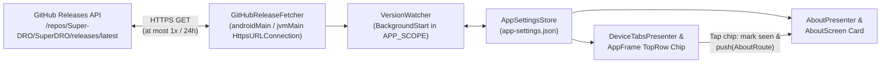

# Release notification plan

This document gives the design and the implementation plan for the new-release notification system
in SuperDRO. Read [docs/versioning-and-release-plan.md](versioning-and-release-plan.md) for the
calendar version rules and the GitHub Release workflow.

## 1. Goals and rules

The release notification system has these six properties:

1. **GitHub Release source.** When `.github/workflows/build-release.yml` publishes a release on
   GitHub (`make_latest: true`), the app reads the new version from the public GitHub Releases API.
2. **All platforms.** The check and the UI run in common code (`core:app-version`, `core:model`,
   `core:ui`, `core:di`) on Android (`app:android`) and on the desktop (`app:desktop` on Linux,
   Windows, and macOS).
3. **No disruption.** No dialog, no sound, and no system notification interrupts the user:
   - A compact chip shows in `TopRow` of `AppFrame` when an unseen release is available.
   - One tap on the chip marks the version as seen, hides the chip, and opens `Settings > About`.
   - `Settings > About` (`VersionGroup`) shows an "Update available" card with a button that opens
     the GitHub Release page in the browser.
4. **At most one check each day.** The app stores the wall-clock time (`lastReleaseCheckEpochMs`) of
   the last check in `app-settings.json` (`AppSettingsStore`). The app checks GitHub only when at
   least 24 hours (`86_400_000 ms`) passed after the last check. Multiple releases on the same day
   never cause more than one check or more than one notification in a 24-hour window.
5. **At most one notification for each version.** The app stores `notifiedReleaseVersion` in
   `AppSettings`. After the user taps the top-bar chip (or opens the release from `AboutScreen`) for
   version `X`, the top-bar chip never shows again for version `X`.
6. **User switch.** `Settings > App` (`AppearanceGroup`) has a switch (`checkForUpdates`, on by
   default) that turns automatic release checks on or off.

## 2. Architecture



### 2.1 Version parsing and comparison (`core:app-version`)

[docs/versioning-and-release-plan.md](versioning-and-release-plan.md) (section 3) defines the
calendar version `<year>.<week>.<count>` and its integer code:

```
code = (year mod 100) × 100000 + week × 1000 + count
```

Add `ReleaseVersion` in `core/app-version/src/commonMain/kotlin/org/superdro/core/appversion/ReleaseVersion.kt`:

- `parseTag(tag: String): String?` accepts only a clean release tag `v<year>.<week>.<count>` (or
  `<year>.<week>.<count>`) and removes the `v` prefix (for example, `"v26.42.2"` gives `"26.42.2"`).
  It gives `null` for each other tag or suffix.
- `codeOf(version: String): Int?` parses `<year>.<week>.<count>` and gives
  `(year % 100) * 100000 + week * 1000 + count`. It gives `null` when `week !in 1..53` or
  `count !in 1..999`.
- `isNewer(remoteVersion: String, currentCode: Int = AppVersion.CODE): Boolean` gives `true` when
  `codeOf(remoteVersion)` is not `null` and is greater than `currentCode`.

## 3. Stored state and rate-limit rules (`core:model` and `core:ui`)

### 3.1 `AppSettings` fields (`core/model/src/commonMain/kotlin/org/superdro/core/model/AppSettings.kt`)

Each new field has a default value so that old `app-settings.json` files load with no migration:

```kotlin
/** True when the app checks GitHub for a new release at most once a day. */
val checkForUpdates: Boolean = true,
/** The wall-clock time in epoch milliseconds of the last release check, or 0 before the first check. */
val lastReleaseCheckEpochMs: Long = 0L,
/** The newest release version found on GitHub (for example "26.42.2"), or null. */
val availableReleaseVersion: String? = null,
/** The URL of the GitHub Release page for [availableReleaseVersion], or null. */
val availableReleaseUrl: String? = null,
/** The last release version whose notification the user already saw. */
val notifiedReleaseVersion: String? = null,
```

### 3.2 Pure rules in `VersionCheck` (`core/ui/src/commonMain/kotlin/org/superdro/core/ui/settings/about/AboutModel.kt`)

All timing and notification rules live in pure functions on `VersionCheck`:

| Function | Rule |
|---|---|
| `afterStart(settings, currentName, currentCode)` | Updates `lastRunVersion` and `whatChangedPending`. If `availableReleaseVersion` is not newer than `currentCode` (the user installed the update), sets `availableReleaseVersion = null` and `availableReleaseUrl = null`. |
| `shouldCheckRelease(settings, nowEpochMs)` | Gives `true` when `settings.checkForUpdates` is `true` and either `settings.lastReleaseCheckEpochMs <= 0L`, `nowEpochMs < settings.lastReleaseCheckEpochMs` (the system clock moved back), or `nowEpochMs - settings.lastReleaseCheckEpochMs >= CHECK_INTERVAL_MS` (`86_400_000L`, 24 hours). |
| `afterReleaseCheck(settings, remote, nowEpochMs, currentCode)` | Sets `lastReleaseCheckEpochMs = nowEpochMs`. When `remote != null` and `ReleaseVersion.isNewer(remote.version, currentCode)`, sets `availableReleaseVersion = remote.version` and `availableReleaseUrl = remote.htmlUrl`. When `remote != null` and `!ReleaseVersion.isNewer(remote.version, currentCode)`, clears `availableReleaseVersion` and `availableReleaseUrl`. |
| `unseenReleaseVersion(settings, currentCode)` | Gives `availableReleaseVersion` when `settings.checkForUpdates` is `true`, `ReleaseVersion.isNewer(availableReleaseVersion, currentCode)` is `true`, and `availableReleaseVersion != settings.notifiedReleaseVersion`. Else gives `null`. |
| `acknowledgeRelease(settings)` | Sets `notifiedReleaseVersion = settings.availableReleaseVersion ?: settings.notifiedReleaseVersion`. |

Writing `lastReleaseCheckEpochMs` when a check completes ensures that the app checks at most once in
24 hours. Even if several releases come out on the same day, the app does not check again and does
not notify the user again on that day.

## 4. Network check across platforms (`core:ui`)

### 4.1 Endpoint and JSON payload

- **URL:** `https://api.github.com/repos/Super-DRO/SuperDRO/releases/latest`
- **Request headers:**
  - `Accept: application/vnd.github+json`
  - `X-GitHub-Api-Version: 2022-11-28`
  - `User-Agent: SuperDRO`
- **Payload model** (parsed with `SuperDroJson`):
  ```kotlin
  @Serializable
  internal data class GitHubLatestReleasePayload(
      @SerialName("tag_name") val tagName: String = "",
      @SerialName("html_url") val htmlUrl: String = "",
      val draft: Boolean = false,
      val prerelease: Boolean = false,
  )
  ```
- **Validation:** `parseLatestReleaseJson(raw: String): RemoteRelease?` refuses a draft or a
  prerelease, parses `tagName` with `ReleaseVersion.parseTag`, and checks that `htmlUrl` starts with
  `https://github.com/Super-DRO/SuperDRO/releases/` (or uses
  `https://github.com/Super-DRO/SuperDRO/releases/tag/v$version`).

### 4.2 Transport and `VersionWatcher` loop

`core:ui` defines `ReleaseFetcher`:

```kotlin
@Immutable
data class RemoteRelease(val version: String, val htmlUrl: String)

fun interface ReleaseFetcher {
    suspend fun fetchLatest(): RemoteRelease?
}
```

- Both Android (`app:android` already declares `android.permission.INTERNET`) and Desktop (`jvmMain`)
  have `HttpsURLConnection` in the standard library. No new third-party dependency is necessary.
- `expect suspend fun fetchReleaseJson(url: String, timeoutMs: Int): String?` runs on
  `Dispatchers.IO` with a `5_000 ms` timeout and returns `null` on any `IOException` or non-200
  status.
- `VersionWatcher.start(scope)` loads `AppSettingsStore`, runs `VersionCheck.afterStart`, and then
  runs the check loop:
  1. While `!settings.checkForUpdates`, wait until `checkForUpdates` becomes `true`.
  2. When `VersionCheck.shouldCheckRelease(settings, clock.now().toEpochMilliseconds())` is `false`,
     delay until the end of the 24-hour window.
  3. Call `releaseFetcher.fetchLatest()`.
  4. When the call returns a release, write `VersionCheck.afterReleaseCheck` to `AppSettingsStore`
     and delay `24 hours`.
  5. When the call returns `null` (for example, the tablet has no internet connection in the
     workshop), do not write `lastReleaseCheckEpochMs`; wait `1 hour` in memory before the next try.

## 5. User interface (`core:ui`)

### 5.1 Top-bar indicator chip (`AppFrame.kt` and `DeviceTabsPresenter.kt`)

- `DeviceTabsUiState` adds `val availableUpdateVersion: String? = null`.
- `DeviceTabsPresenter` reads `AppSettingsStore.settings` and sets `availableUpdateVersion` from
  `VersionCheck.unseenReleaseVersion(settings, currentVersionCode)`.
- `DeviceTabsEvents` adds `fun onAcknowledgeUpdate() = Unit`, which updates `AppSettingsStore` with
  `VersionCheck::acknowledgeRelease`.
- In `TopRow` of `AppFrame.kt`, when `state.availableUpdateVersion != null`, show
  `UpdateAvailableIndicator` before the `+` button:
  - Uses `MaterialTheme.colorScheme.tertiaryContainer` and `onTertiaryContainer` (the same colors as
    `NewMarker` in `AboutScreen.kt`), with `Res.drawable.ic_info` and the version text.
  - Has the minimum touch target `LocalTouchTargets.current.button` and the test tag
    `UPDATE_AVAILABLE_TAG = "updateAvailable"`.
  - A tap calls `events.onAcknowledgeUpdate()` and `navigation.push(AboutRoute)`.

### 5.2 "Update available" card in `Settings > About` (`AboutScreen.kt` and `AboutPresenter.kt`)

- `AboutUiState` adds `val availableReleaseVersion: String? = null` and
  `val availableReleaseUrl: String? = null`.
- `AboutEvents` adds `fun onOpenRelease()`.
- When `state.availableReleaseVersion != null`, `VersionGroup` in `AboutScreen.kt` shows
  `UpdateAvailableSection` at the top:
  - Shows `NewMarker()` and `stringResource(Res.string.settings_about_update_available, version)`.
  - Shows a `FilledTonalButton` with test tag `ABOUT_OPEN_RELEASE_TAG = "about-open-release"` and
    label `stringResource(Res.string.settings_about_open_release)`.
  - A tap calls `events.onOpenRelease()` (which marks `notifiedReleaseVersion`) and opens
    `state.availableReleaseUrl` in the system browser.

### 5.3 Switch in `Settings > App` (`AppSettingsScreen.kt` and `AppSettingsPresenter.kt`)

- `AppSettingsPresenter` adds `fun setCheckForUpdates(on: Boolean)`.
- `AppearanceGroup` in `AppSettingsScreen.kt` adds a `SettingsSwitch` with tag
  `AppSettingsTags.CHECK_FOR_UPDATES = "app-check-updates"`.

## 6. Files to change

| Module | File | Change |
|---|---|---|
| `core:app-version` | `src/commonMain/kotlin/org/superdro/core/appversion/ReleaseVersion.kt`, `src/jvmTest/kotlin/org/superdro/core/appversion/ReleaseVersionTest.kt` | Add `ReleaseVersion.parseTag`, `codeOf`, and `isNewer` with unit tests. |
| `core:model` | `src/commonMain/kotlin/org/superdro/core/model/AppSettings.kt`, `src/commonTest/kotlin/org/superdro/core/model/SerializationRoundTripTest.kt` | Add `checkForUpdates`, `lastReleaseCheckEpochMs`, `availableReleaseVersion`, `availableReleaseUrl`, and `notifiedReleaseVersion`. |
| `core:resources` | `values*/strings_settings_about.xml`, `values*/strings_settings_app.xml` (`values`, `values-es`, `values-fr`, `values-de`, `values-pt-rBR`, `values-nl`) | Add strings for the top-bar chip, the About card and button, and the App Settings switch. |
| `core:ui` | `src/commonMain/kotlin/org/superdro/core/ui/settings/about/ReleaseFetcher.kt`, `src/androidMain/.../PlatformReleaseHttp.android.kt`, `src/jvmMain/.../PlatformReleaseHttp.jvm.kt` | Add `ReleaseFetcher`, `GitHubReleaseFetcher`, JSON parser, and external URL opener. |
| `core:ui` | `src/commonMain/kotlin/org/superdro/core/ui/settings/about/AboutModel.kt`, `AboutPresenter.kt`, `AboutScreen.kt`, `AboutEntry.kt` | Add `VersionCheck` release rules, `VersionWatcher` 24-hour check loop, and `UpdateAvailableSection`. |
| `core:ui` | `src/commonMain/kotlin/org/superdro/core/ui/settings/app/AppSettingsPresenter.kt`, `AppSettingsScreen.kt` | Add `setCheckForUpdates` and the switch in `AppearanceGroup`. |
| `core:ui` | `src/commonMain/kotlin/org/superdro/core/ui/tabs/DeviceTabsUiState.kt`, `DeviceTabsPresenter.kt`, `AppFrame.kt` | Add `availableUpdateVersion`, `onAcknowledgeUpdate()`, and `UpdateAvailableIndicator` in `TopRow`. |
| `core:di` | `src/commonMain/kotlin/org/superdro/core/di/SettingsAboutModule.kt`, `UiModule.kt`, `src/jvmMain/kotlin/org/superdro/core/di/NoOpPlatformModule.kt` | Bind `ReleaseFetcher` and `kotlin.time.Clock` into `VersionWatcher` and `DeviceTabsPresenter`. |
| `docs` | `docs/versioning-and-release-plan.md` | Reference the release notification rules. |

## 7. Verification plan

1. **Unit tests (`:core:app-version:jvmTest`, `:core:model:jvmTest`):**
   - Test `ReleaseVersion.parseTag`, `codeOf`, and `isNewer` on release tags, `-dev` versions, year
     boundaries (`26.52.9` to `27.1.1`), and bad tags.
   - Test `AppSettings` JSON serialization round-trip and defaults.
2. **Presenter and watcher tests (`:core:ui:jvmTestSettings`, `:core:ui:jvmTestTabs`):**
   - Test that `VersionWatcher` checks at start when `lastReleaseCheckEpochMs == 0`, skips the check
     when less than 24 hours passed, and checks again after 24 hours.
   - Test that multiple releases in the same 24-hour window do not cause a second check or a second
     notification.
   - Test that `notifiedReleaseVersion` prevents a second top-bar notification for the same version,
     while a newer version (`26.42.3` after `26.42.2`) notifies after the next 24-hour window.
   - Test that `checkForUpdates = false` stops both the network check and the top-bar chip.
3. **UI and localization checks:**
   - Add Compose UI tests in `AboutScreenUiTest`, `AppSettingsUiTest`, and `AppFrame` tests for the
     top-bar chip, the navigation to `AboutScreen`, and the GitHub release button.
   - Run `:core:resources:localizationCheck` and `scripts/validate.sh`.
