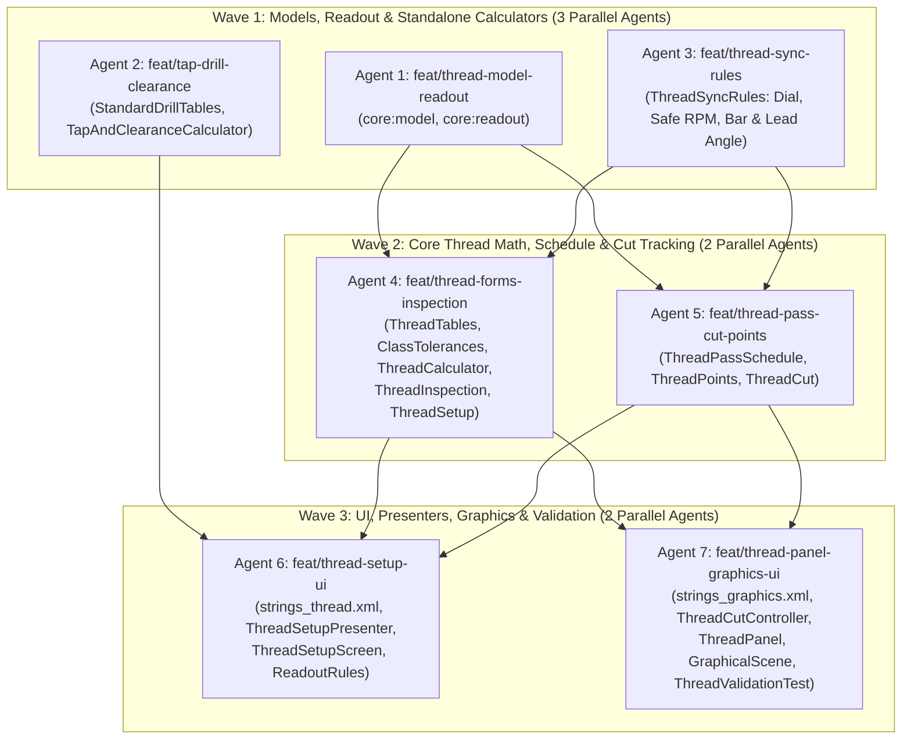

# Thread cutting implementation plan

This document divides the work of [docs/thread-cutting-spike.md](thread-cutting-spike.md) into three
waves and seven agent tracks. Parallel agents in the same wave touch different files, so their
branches merge with no conflicts.

## 1. Work rules for all agents

Each agent must follow [CLAUDE.md](../CLAUDE.md):

1. Work only in your own worktree (`.worktrees/<track>`) on your own branch (`feat/<track>`). Never
   commit on `main`, and never merge, rebase, or push unless the coordinator tells you to.
2. Write all comments, KDoc, documents, and commit messages in ASD-STE100 Simplified Technical
   English. Do not add `Co-Authored-By` trailers or AI markers.
3. Keep all lengths in micrometers (`Double`) and all angles in arc seconds (`Double`).
4. Run only the Gradle tasks of the modules that you change, with the memory-limit flags:
   ```bash
   ./gradlew --max-workers=4 -Dorg.gradle.jvmargs="-Xmx6g -XX:+UseParallelGC" \
     -Pkotlin.compiler.execution.strategy=in-process <tasks>
   ```
5. Put UI strings only in the string file of your area (`strings_thread.xml`,
   `strings_graphics.xml`, or `strings_settings_machine.xml`) across all six locales (`values`,
   `values-es`, `values-fr`, `values-de`, `values-pt-rBR`, `values-nl`).

## 2. Wave dependency graph



## 3. Wave 1: Models, readout, and standalone calculators

All three tracks in Wave 1 start from `main` at the same time.

### Agent 1: `feat/thread-model-readout`

- **Modules**: `core:model`, `core:readout`
- **Owned files**:
  - `core/model/src/commonMain/kotlin/org/superdro/core/model/ThreadSpec.kt`
  - `core/model/src/commonMain/kotlin/org/superdro/core/model/MachineProfile.kt`
  - `core/model/src/commonMain/kotlin/org/superdro/core/model/Workspace.kt`
  - `core/model/src/commonTest/kotlin/org/superdro/core/model/SerializationRoundTripTest.kt`
  - `core/model/src/commonTest/kotlin/org/superdro/core/model/WorkspaceDefaultsTest.kt`
  - `core/readout/src/commonMain/kotlin/org/superdro/core/readout/ReadoutFrame.kt`
  - `core/readout/src/commonMain/kotlin/org/superdro/core/readout/operations/AxisOperations.kt`
  - `core/readout/src/commonTest/kotlin/org/superdro/core/readout/AxisOperationsTest.kt`
- **Tasks**:
  1. Expand `ThreadForm` in `ThreadSpec.kt` with `Bsw`, `Bsf`, `Bspp`, `IsoTrapezoidal`, `Acme`,
     `Npt`, and `Bspt`.
  2. Expand `ThreadClass` in `ThreadSpec.kt` with `ClassA`, `ClassB`, `ClassMedium`, `Class7e`,
     `Class7H`, `Class2G`, and `Class3G`.
  3. Add `@Serializable enum class ThreadInfeedMode { Radial, ModifiedFlank, Flank }` and
     `@Serializable enum class PartialInsertPreset { Custom, A60, G60, AG60, N60 }` to
     `ThreadSpec.kt`.
  4. Add optional fields with default values to `ThreadSpec`:
     - `leftHand: Boolean = false`
     - `starts: Int = 1`
     - `infeedMode: ThreadInfeedMode = ThreadInfeedMode.ModifiedFlank`
     - `roughingPasses: Int? = null`
     - `wireDiameterUm: Double? = null`
     - `insertPreset: PartialInsertPreset = PartialInsertPreset.Custom`
  5. Add `leadscrewPitchUm: Double? = null` to `MachineProfile`.
  6. Add `referenced: Boolean = false` to `AxisState` in `Workspace.kt` and `referenced: Boolean = false`
     to `AxisReading` in `ReadoutFrame.kt`.
  7. In `AxisOperations.kt` and `ReadoutPipeline`, set `AxisState.referenced = true` when the user
     zeros an axis in absolute mode, presets an absolute dimension, or centers in absolute mode, and
     copy `axisState.referenced` to `AxisReading.referenced`.
  8. Add round-trip JSON serialization tests and readout reference state tests.
- **Verification**:
  - `./gradlew :core:model:jvmTest :core:readout:jvmTest :core:store:jvmTest`

### Agent 2: `feat/tap-drill-clearance`

- **Module**: `core:functions`
- **Owned files (new)**:
  - `core/functions/src/commonMain/kotlin/org/superdro/core/functions/thread/StandardDrillTables.kt`
  - `core/functions/src/commonMain/kotlin/org/superdro/core/functions/thread/TapAndClearanceCalculator.kt`
  - `core/functions/src/commonTest/kotlin/org/superdro/core/functions/thread/StandardDrillTablesTest.kt`
  - `core/functions/src/commonTest/kotlin/org/superdro/core/functions/thread/TapAndClearanceCalculatorTest.kt`
- **Tasks**:
  1. Create `StandardDrillTables` with the standard metric (0.1 mm steps from 1.0 mm to 68.0 mm plus
     standard 0.05 mm tap sizes), number (#80 to #1), letter (A to Z), and fractional (1/64 in to
     2 in) drill series in µm. Provide `nearestDrills(targetDiameterUm: Double)` returning the
     closest smaller or equal drill and the closest larger or equal drill.
  2. Create `TapAndClearanceCalculator`:
     - Cut tap drill diameter for 60° (`D − (pct / 100) × 1.2990381 × P`) and 55°
       (`D − (pct / 100) × 1.2806548 × P`) threads for `pct` in `50.0..85.0`, plus actual thread
       engagement percentage for a selected drill diameter and whether the drill is inside
       `[D1min, D1max]`.
     - Roll-form tap drill diameter for 60° threads (`D − (pct / 100) × 0.68 × P`) and nearest
       standard drills.
     - Fastener clearance hole diameters (close, normal, and loose fit per ISO 273 and ASME B18.2.8),
       90° entry countersink diameter (`D + 300 µm`), and minimum blind-hole drill depth for taper
       (`9 × P`), plug (`4.5 × P`), and bottoming (`2.5 × P`) taps.
  3. Add unit tests covering M3, M6, M10 × 1.5, 1/4-20 UNC, #10-32 UNF, and G 1/4 BSPP.
- **Verification**:
  - `./gradlew :core:functions:jvmTest`

### Agent 3: `feat/thread-sync-rules`

- **Module**: `core:functions`
- **Owned files (new)**:
  - `core/functions/src/commonMain/kotlin/org/superdro/core/functions/thread/ThreadSyncRules.kt`
  - `core/functions/src/commonTest/kotlin/org/superdro/core/functions/thread/ThreadSyncRulesTest.kt`
- **Tasks**:
  1. Implement `ThreadDialRule` (`KeepHalfNutClosed`, `AnyPoint`, `AnyLine`, `AnyNumberedLine`,
     `OppositeNumberedLines`, `SameLineOnly`) and `ThreadSyncRules.dialRule(leadUm, threadMetric, leadscrewPitchUm, leadscrewMetric)`:
     - Return `KeepHalfNutClosed` when `threadMetric != leadscrewMetric`.
     - Compute the exact half-nut engagement rule for imperial TPI leads on an imperial leadscrew
       and metric leads on a metric leadscrew.
  2. Implement `ThreadSyncRules.safeRpm(leadUm, exitReliefUm, pitchUm, internal)` and
     `ThreadSyncRules.reactionWindowSeconds(rpm, leadUm, exitReliefUm, pitchUm)` using
     `W_stop = max(exitReliefUm ?: 0.0, 1.5 × pitchUm)` and `t_react = if (internal) 1.5 else 1.0`.
  3. Implement `ThreadSyncRules.pitchCheck(measuredFeedPerRevUm, targetLeadUm)` returning `Match`
     when `|measured − target| / target ≤ 0.03` or `Mismatch(measuredUm, targetUm)` otherwise.
  4. Implement `ThreadSyncRules.internalBarRecommendation(minorDiameterUm, lengthUm)` using the
     standard holder minimum bores (`06IR`: 6000 µm, `08IR`: 8000 µm, `11IR`: 11000 µm, `16IR`:
     16000 µm, `22IR`: 20000 µm, or `CarbideMicroBar` below 6000 µm) and flagging deflection risk
     when `lengthUm > 3.5 × shankDiameterUm`.
  5. Implement `ThreadSyncRules.leadAngleArcSec(leadUm, pitchDiameterUm)` (`arctan(lead / (π × d2))`
     in arc seconds) and `needsAnvilTilt(leadAngleArcSec)` (`> 9000.0` arc seconds, or `2.5°`).
  6. Write unit tests for all five functions.
- **Verification**:
  - `./gradlew :core:functions:jvmTest`

---

## 4. Wave 2: Core thread math, pass schedule, and cut tracking

Wave 2 starts after the coordinator merges Wave 1 into `main`. Both Wave 2 agents work in parallel
in `core:functions` on disjoint files.

### Agent 4: `feat/thread-forms-inspection`

- **Module**: `core:functions`
- **Owned files**:
  - `core/functions/src/commonMain/kotlin/org/superdro/core/functions/thread/ThreadUnit.kt`
  - `core/functions/src/commonMain/kotlin/org/superdro/core/functions/thread/ThreadTables.kt`
  - `core/functions/src/commonMain/kotlin/org/superdro/core/functions/thread/ClassTolerances.kt`
  - `core/functions/src/commonMain/kotlin/org/superdro/core/functions/thread/ThreadCalculator.kt`
  - `core/functions/src/commonMain/kotlin/org/superdro/core/functions/thread/ThreadInspection.kt` (new)
  - `core/functions/src/commonMain/kotlin/org/superdro/core/functions/thread/ThreadSetup.kt`
  - `core/functions/src/commonTest/kotlin/org/superdro/core/functions/thread/ThreadTablesTest.kt`
  - `core/functions/src/commonTest/kotlin/org/superdro/core/functions/thread/ThreadCalculatorTest.kt`
  - `core/functions/src/commonTest/kotlin/org/superdro/core/functions/thread/ThreadInspectionTest.kt` (new)
  - `core/functions/src/commonTest/kotlin/org/superdro/core/functions/thread/ThreadSetupTest.kt`
- **Tasks**:
  1. Update `ThreadUnit.kt` (`unit`, `isCustom`, `includedAngleDeg`, `taperRatio`, `classesFor`) for
     `Bsw`, `Bsf`, `Bspp`, `IsoTrapezoidal`, `Acme`, `Npt`, and `Bspt`, and map
     `PartialInsertPreset` (`A60` → 55 µm, `G60` → 200 µm, `AG60` → 60 µm, `N60` → 400 µm) and its
     valid pitch range.
  2. Add the size tables in `ThreadTables.kt` for `Bsw`, `Bsf`, `Bspp` (G 1/16 to G 2),
     `IsoTrapezoidal` (`Tr 8 × 1.5` to `Tr 60 × 9`), `Acme` (`1/4-16` to `2-4`), `Npt` (`1/16` to
     `2`), and `Bspt` (`1/16` to `2`).
  3. Add tolerance calculations in `ClassTolerances.kt` for ISO 228-1 (`Bspp`), BS 84 (`Bsw`,
     `Bsf`), ISO 2903 (`7e`, `7H` for `IsoTrapezoidal`), and ASME B1.5 (`2G`, `3G` for `Acme`).
  4. Create `ThreadInspection.kt`:
     - Best wire diameter `W_best = P / (2 × cos(α / 2))` and valid wire range `[W_min, W_max]`.
     - Three-wire measurement `M(E, W)` with custom wire `W` and Buckingham lead-angle correction
       `C_wire = W × (1 + 1 / sin θ + 0.5 × tan²(λ) × cos θ × cot θ) − P / (2 × tan θ)`, plus
       `sec²(β)` taper correction at `E0` and `E1` for `Npt` and `Bspt`.
     - Actual pitch diameter `E_actual = M_measured − C_wire` and remaining radial depth
       `Δr_rem = max(0, (M_measured − M_target) / 2)`.
     - Internal thread Go/No-Go minor pin-gauge (`[D1min, D1max]`) and pitch plug-gauge
       (`[D2min, D2max]`) limits.
  5. Extend `ThreadGeometry` and `ThreadCalculator.kt` for all forms, relief groove diameter
     (`reliefDiameterUm`), entry chamfer diameter (`entryChamferDiameterUm`), root flat width (`w`),
     lead (`leadUm`), lead angle (`leadAngleArcSec`), internal bar recommendation, and
     `ThreadInspection` outputs.
  6. Update `ThreadSetup.kt` (`ThreadSetupInput`, `validate`, `calculate`, `toSpec`, `restore`) for
     the new fields on `ThreadSpec`.
- **Verification**:
  - `./gradlew :core:functions:jvmTest`

### Agent 5: `feat/thread-pass-cut-points`

- **Module**: `core:functions`
- **Owned files**:
  - `core/functions/src/commonMain/kotlin/org/superdro/core/functions/thread/ThreadPassSchedule.kt` (new)
  - `core/functions/src/commonMain/kotlin/org/superdro/core/functions/thread/ThreadPoints.kt`
  - `core/functions/src/commonMain/kotlin/org/superdro/core/functions/thread/ThreadCut.kt`
  - `core/functions/src/commonTest/kotlin/org/superdro/core/functions/thread/ThreadPassScheduleTest.kt` (new)
  - `core/functions/src/commonTest/kotlin/org/superdro/core/functions/thread/ThreadPointsTest.kt`
  - `core/functions/src/commonTest/kotlin/org/superdro/core/functions/thread/ThreadCutTest.kt`
- **Tasks**:
  1. Create `ThreadPassSchedule.kt`:
     - Compute the default roughing pass count from the pitch and the total radial depth
       `h_total = |cutToDiameterUm − preOpDiameterUm| / 2`.
     - Compute the root flat width `w` (`Fr` for `Acme`, `f` for `IsoTrapezoidal`, `P / 4` for
       `FullForm` on 60°/55°, `0` for `SharpV`/`Partial` on 60°/55°).
     - Solve the constant chip-area positive root
       `h_k = (-w + sqrt(w² + 4 × tan(α / 2) × (k / N_rough) × A(h_rough))) / (2 × tan(α / 2))`
       with the minimum radial step floor of `25 µm`, followed by the finish pass (`35 µm` default)
       and spring passes.
     - Compute `stepRadialUm`, `cumulativeRadialUm`, `targetDiameterUm`, `compoundStepUm`
       (`Δr / cos(β_infeed)`), and `compoundZShiftUm` (`Δr × tan(β_infeed)`) for each pass.
  2. Update `ThreadPoints.kt`:
     - Select the finish corner at `Zmax` when `spec.leftHand` is true and at `Zmin` when
       `spec.leftHand` is false.
     - Add `startOffsets(spec: ThreadSpec): List<ThreadStartOffset>` giving the Z offset
       `(m − 1) × P` and spindle angle offset `1_296_000.0 × (m − 1) / starts` arc seconds for each
       start `m` in `1..starts`.
  3. Update `ThreadCut.kt`:
     - Handle `spec.leftHand` in `retractLimitZUm` (`max(startZUm, stopZUm) + (rightReliefUm ?: 0.0)`)
       and `retractState` (past limit when `zUm > retractLimitZUm` for a left-hand thread).
     - Generalize `chipArea` for the included angle `α` and root flat width `w` of `spec.form`.
     - Add active pass matching (`currentPassIndex`, `nextTargetDiameterUm`, `nextCompoundStepUm`)
       from `ThreadPassSchedule` and `record.deepestUm`, and multi-start tracking (`activeStart` in
       `1..spec.starts`).
- **Verification**:
  - `./gradlew :core:functions:jvmTest`

---

## 5. Wave 3: UI, presenters, graphics, and validation

Wave 3 starts after the coordinator merges Wave 2 into `main`. Both Wave 3 agents work in parallel
on disjoint string files and UI packages.

### Agent 6: `feat/thread-setup-ui`

- **Modules**: `core:resources`, `core:ui`
- **Owned files**:
  - `core/resources/src/commonMain/composeResources/values*/strings_thread.xml` (all 6 languages)
  - `core/ui/src/commonMain/kotlin/org/superdro/core/ui/functions/thread/ThreadSetupPresenter.kt`
  - `core/ui/src/commonMain/kotlin/org/superdro/core/ui/functions/thread/ThreadSetupScreen.kt`
  - `core/ui/src/commonMain/kotlin/org/superdro/core/ui/readout/ReadoutRules.kt`
  - `core/ui/src/jvmTest/kotlin/org/superdro/core/ui/functions/thread/ThreadSetupPresenterTest.kt`
  - `core/ui/src/jvmTest/kotlin/org/superdro/core/ui/functions/thread/ThreadSetupScreenTest.kt`
- **Tasks**:
  1. Add the localized strings for the new thread forms, hand and starts, partial insert presets,
     infeed modes, pass schedule table headers, tap/form-tap/clearance results, internal Go/No-Go
     limits, and tooling/sync notices to `strings_thread.xml` in all six languages.
  2. In `ReadoutRules.kt`, enable `FunctionButton.ThreadSetup` on mill profiles as well as lathe
     profiles.
  3. Update `ThreadSetupPresenter.kt` and `ThreadSetupScreen.kt`:
     - Add the mode selector (`Single-Point Thread` vs. `Tap & Hole Prep`; default to `Tap & Hole Prep`
       on mill profiles and `Single-Point Thread` on lathe profiles).
     - Add controls for the new `ThreadForm` entries, `Right-Hand` / `Left-Hand`, `Starts`,
       `PartialInsertPreset` chips (`A60`, `G60`, `AG60`, `N60`, `Custom`), `ThreadInfeedMode`
       (`Radial`, `Modified Flank`, `Flank`), roughing pass count override, and custom `Wire Diameter`
       + `Measured Over Wires` inputs.
     - Expand the `Results` preview pane with:
       - Pre-machining relief groove diameter (`dg`/`Dg`), entry chamfer/countersink, internal bar
         minimum bore and overhang warning, and helix lead angle with flank clearance warning.
       - Tap drill, roll-form tap drill, nearest standard drills (Metric, Fractional, Number,
         Letter), blind-hole depth allowance, and fastener clearance holes.
       - Inspection section: custom 3-wire + remaining radial depth for external threads; Go/No-Go
         minor pin-gauge and pitch diameter limits for internal threads.
       - Synchronization section: threading dial rule and safe RPM limit.
       - Pass schedule table (`Pass`, `Type`, `Δr`, `Target Ø`, `Compound`).
  4. Add presenter and Compose UI tests in `ThreadSetupPresenterTest` and `ThreadSetupScreenTest`.
- **Verification**:
  - `./gradlew :core:resources:localizationCheck :core:ui:jvmTest`

### Agent 7: `feat/thread-panel-graphics-ui`

- **Modules**: `core:resources`, `core:ui`, `validation`
- **Owned files**:
  - `core/resources/src/commonMain/composeResources/values*/strings_graphics.xml` (all 6 languages)
  - `core/resources/src/commonMain/composeResources/values*/strings_settings_machine.xml` (all 6 languages)
  - `core/ui/src/commonMain/kotlin/org/superdro/core/ui/graphics/thread/ThreadCutController.kt`
  - `core/ui/src/commonMain/kotlin/org/superdro/core/ui/graphics/thread/ThreadPanel.kt`
  - `core/ui/src/commonMain/kotlin/org/superdro/core/ui/graphics/view/GraphicalScene.kt`
  - `core/ui/src/commonMain/kotlin/org/superdro/core/ui/settings/machine/MachineSettingsPresenter.kt`
  - `core/ui/src/commonMain/kotlin/org/superdro/core/ui/settings/machine/MachineSettingsScreen.kt`
  - `core/ui/src/commonTest/kotlin/org/superdro/core/ui/graphics/view/ThreadOutlineCacheTest.kt`
  - `validation/src/test/kotlin/org/superdro/validation/functions/ThreadValidationTest.kt`
- **Tasks**:
  1. Add the localized strings for the live pass target, pass reset, multi-start selector, threading
     dial badge, live pitch check, relief reaction window, X-not-referenced warning, and lathe
     leadscrew pitch setting to `strings_graphics.xml` and `strings_settings_machine.xml` in all six
     languages.
  2. Add the optional `Leadscrew Pitch` setting on lathe profiles in `MachineSettingsPresenter.kt`
     and `MachineSettingsScreen.kt`.
  3. Update `ThreadCutController.kt` and `ThreadPanel.kt`:
     - Pass `xReferenced = x.referenced` to `ThreadCut.values` and render the
       `ThreadCutWarning.XNotReferenced` banner in `ThreadPanel` (fixing D135).
     - Show the current pass target from `ThreadPassSchedule` (`Pass k / N`, next target X diameter,
       compound step, and a `Reset passes` action).
     - Show the active start selector (`Start m / M`) for multi-start threads and activate the
       shifted start sub-datum or Z offset.
     - Show the threading dial rule, live Z-pitch check against `Lead` when the tachometer is
       active, and the reaction window in the relief groove.
  4. Update `GraphicalSceneBuilder.threadOutline` in `GraphicalScene.kt` for left-hand reliefs,
     trapezoidal/Acme flat roots, and 1:16 tapered pipe profiles.
  5. Expand `ThreadValidationTest.kt` and `ThreadOutlineCacheTest.kt` to cover all new thread forms,
     pass schedules, left-hand and multi-start threads, and the `XNotReferenced` warning.
- **Verification**:
  - `./gradlew :core:resources:localizationCheck :core:ui:jvmTest :validation:test`
